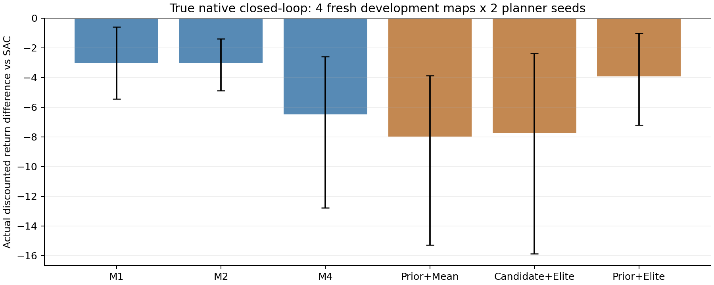
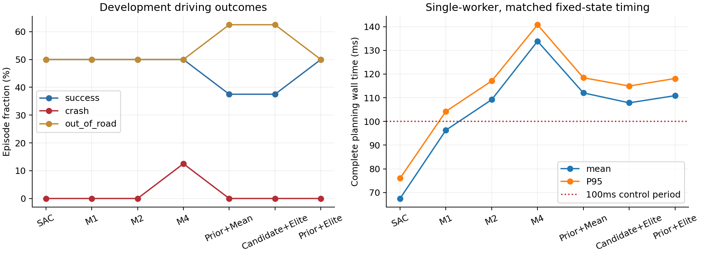

# MPPI动作评价与选择：真实闭环消融

**本轮完成修改与实验，但没有获得相对Lattice+SAC的可重复正收益。当前冻结WM/Q/SAC组合下，不建议启用这些实验配置或继续增加头、采样量与规则。** 这不是证明所有MPPI结构不可能有效，而是本轮预定开发样本未通过验收。独立验证6张新地图保持封存，没有用于再选参数。

代码基线 `ced768831d7c79e16b5e7799dfcc07267ee1a52f`，开始时工作区干净。原checkpoint SHA256 `4d0f1d43749794d1d1c28533309cbe75bc3712d25a92936ca7b477c30014810a`；没有训练、覆盖checkpoint、修改SAC535维输入/动作映射、Lattice、环境Reward/Cost/成功或终止规则，没有commit/push/reset。

## 代码修改与语义

- planning/evaluator.py：已有policy_prior确定性均值路径复用；新增可选RNG无扰动的Q成员记录。冻结eval模式WM无随机rollout，pi()未使用采样的RNG被恢复，记录的成员与原Q(avg)实际抽样一致。固定成员供最终Elite复评。
- planning/local_mppi.py：增加selection_mode=weighted_mean/best_final_elite。旧配置没有该字段时走原路径；显式weighted_mean仍只按原Baseline/Mean最终2候选评分决策，额外记录最后轮Elite的共享成员评分。Elite为最后轮原65候选中预测Top1（可能是Baseline），不跨轮选择、不看真实未来Return；用最终Baseline/Mean同一Q成员复评后，仅严格高于Baseline才执行。
- Elite复用已计算的prefix Reward、terminal latent、discount/termination，只重算终端价值，没有增加H步WM rollout。64个Gaussian+额外Baseline、8个Elite、AR(1)、Mean/Std更新和温度均未改。K轮完整候选推演仍为K×65+2，4轮262。Baseline与Mean最终同批，缓存Elite同成员；未声称三个完整rollout都是同一batch。
- 新record_candidates只记录，不重评分/改变RNG；保留全部每轮65候选动作和原始分数/Q成员，三个最终候选、成员、原始Elite索引与选择来源baseline/mean/elite。显式新选择模式使用record_candidates，不与旧audit_candidates的额外随机Q复评混用。
- planning/coordinator.py转交选择/候选trace；planning/types.py只增加Q成员元数据；planning/native_config.py仅允许迁移两个新配置字段。config.yaml、原网络文件及vendor/tdmpc2_runtime/tdmpc2.py未修改。

policy_prior前H步仍为候选物理动作；z_H处使用TD-MPC2 Actor的**squashed deterministic mean**计算Q。H+1接口保留，但填充a_H固定为Baseline填充值、std=0、不参与搜索。它不是Residual SAC的535维策略延续，也不是完全复现原生TD-MPC2随机Actor的行为。candidate模式和旧配置保留，不替换默认。

实验配置示例（仅显式消融，未修改全局默认）：

```yaml
mpr_mpc:
  mppi:
    terminal_action: policy_prior  # control: candidate
    selection_mode: best_final_elite  # control: weighted_mean
    audit_candidates: false
    record_candidates: true
```

## 实验协议与控制变量

预先固定新开发场景[70128, 70124, 70446, 70402]、planner seeds[1, 2]；每组8个原生终止回合、4张地图。场景seed固定道路/交通，repeat seed改变全局和规划随机性，不把同路况的两次运行算两张独立地图。每轮64 Samples/8 Elites、AR(1)、温度beta=.5、Q random_pair、std/rho、TD gamma=.995、cost_weight=0、原生horizon1000全部冻结。

每个控制周期真实重新执行Lattice生成、原SAC残差、当组MPPI、选中首动作、env.step、下一观测重新规划。不是回放H步计划，也不是一次首动作后SAC接管。所有已执行控制步检查Lattice prepare计数==episode length、MPPI计数==length（B为0）、selected_sequence[0]==实际动作、非Baseline预测分数严格高于Baseline。实际tdmpc2_reward逐步累计Episode Return和原gamma折扣Return。

阶段1：B/M1/M2/M4，只改变iterations。阶段2：按开发规则固定一个迭代数，再比较2×2的Terminal Action和Mean/Elite；复用阶段1对应Candidate+Mean对照。阶段1没有合格迭代，M2仅比M1的Return点估计高0.006，故按预先规则选择2轮做后续**诊断**，不是证明2轮优于1轮或可上线。

所有初始观测、车辆/交通和可记录RNG跨方案精确匹配。真实第一周期M2/E的全部搜索动作、值和Q成员完全一致，P/PE亦完全一致；M2/P第一轮前H步Gaussian扰动相同，policy_prior仅固定填充动作并改终端评价。完整检查见trace_verification.json。

## 1/2/4轮真实闭环结果

|组|Success%|Crash%|OOR%|Route%|Episode Return|实际折扣Return|相对B折扣Return [95% CI]|
|---|---:|---:|---:|---:|---:|---:|---:|
|Lattice+SAC|50.0|0.0|50.0|85.1|312.75|144.73|—|
|Candidate / Mean /1|50.0|0.0|50.0|85.2|324.32|141.70|-3.025 [-5.443, -0.610]|
|Candidate / Mean /2|50.0|0.0|50.0|85.0|319.26|141.71|-3.019 [-4.890, -1.395]|
|Candidate / Mean /4|50.0|12.5|50.0|85.4|304.04|138.23|-6.497 [-12.767, -2.611]|

成功率三组均未超过B；M4还在8回合中出现1次碰撞。M1的未折扣Episode Return虽更高，但平均用433.1步，B为395.0步，路线完成率近似；实际折扣Return更低，不能把累积Reward上升当作驾驶效率或任务收益改善。M1/M2的实际折扣Return均比B低约3，M4低约6.50。M2−M1仅约0.006，没有可靠证据证明2轮优于1轮；完整迭代配对CI在factorial_contrasts.json。不要根据预测收益或开发集微小最优点修改默认迭代数。

## Terminal Action和Mean/Elite消融（固定2轮）

|Terminal / Selection|Success%|Crash%|OOR%|Route%|Episode Return|实际折扣Return|相对B折扣Return [95% CI]|
|---|---:|---:|---:|---:|---:|---:|---:|
|Candidate / Mean /2|50.0|0.0|50.0|85.0|319.26|141.71|-3.019 [-4.890, -1.395]|
|Policy prior / Mean /2|37.5|0.0|62.5|79.5|299.48|136.75|-7.974 [-15.287, -3.865]|
|Candidate / Final Elite /2|37.5|0.0|62.5|79.7|287.29|137.00|-7.730 [-15.877, -2.388]|
|Policy prior / Final Elite /2|50.0|0.0|50.0|85.3|312.42|140.80|-3.925 [-7.214, -1.033]|

|单变量配对比较|Success变化百分点 [CI]|OOR变化百分点 [CI]|折扣Return变化 [CI]|
|---|---:|---:|---:|
|Policy prior−Candidate（Mean）|-12.5 [-37.5, 0.0]|12.5 [0.0, 37.5]|-4.954 [-13.937, 0.788]|
|Elite−Mean（Candidate）|-12.5 [-37.5, 0.0]|12.5 [0.0, 37.5]|-4.711 [-14.664, 2.829]|
|Elite−Mean（Policy prior）|12.5 [0.0, 37.5]|-12.5 [-37.5, 0.0]|4.049 [-3.360, 13.361]|
|Policy prior−Candidate（Elite）|12.5 [0.0, 37.5]|-12.5 [-37.5, 0.0]|3.805 [-3.390, 13.929]|

单独采用policy_prior或Final Elite均为37.5%成功、62.5%OOR，差于B及Candidate+Mean的50%/50%；组合回到50%，但折扣Return仍低3.92。不能把组合比某个较差消融更好解释为超过SAC；没有启用未验证Cost或加入新规则补救。



## 模型选择行为与逐场景配对

|方案|Baseline Selected%|首动作修正范数|平均局部预测增益|seed1实际增益|seed2实际增益|
|---|---:|---:|---:|---:|---:|
|M1|2.99|0.070|3.074|-2.244|-3.807|
|M2|0.91|0.113|4.538|-3.485|-2.553|
|M4|0.43|0.172|6.241|-10.348|-2.646|
|P|1.41|0.112|3.956|-9.963|-5.984|
|E|0.60|0.139|5.504|-3.992|-11.467|
|PE|1.09|0.137|4.622|-3.622|-4.228|

M1→M2→M4的首动作修正逐渐增大，Baseline选中率降至不足1%；预测选择仍几乎总偏向优化结果，而实际Return均降低。平均局部预测增益是每步J(candidate)−J(SAC)，不是整集Return增益，二者不能直接相减当误差。两种planner seed的实际增益均为负，没有单个种子支撑的可重复正收益。

逐场景、逐seed的Return/Success/Crash/OOR/Route和配对差在episodes/development/*/episode.json与paired_returns.csv；全部候选、Q成员、实际动作、rewards/done、观测在每回合trace.npz。场景聚类bootstrap2000次、seed1，两个repeat随整张地图一起重采样；未做多重比较校正。样本只有4张地图，不能把56分支当56张地图，也不能据此证明所有MPPI不可能有效。

## 规划耗时

回合报告记录完整agent.act同步wall time，但4个worker共享GPU，不能用这些并行时间判断实时性。采集完成后，在同两张开发地图step30的相同真实状态，单worker分别测100次完整Lattice+SAC+MPPI（每状态50次、5次warmup），关闭候选记录这一诊断开销。没有执行计时中的候选控制，也没有改搜索预算。

硬件：NVIDIA GeForce RTX 3070。完整规划耗时包含Lattice/SAC/WM/最终动作构建；参考控制周期100ms。

|组|Mean(ms)|P50(ms)|P95(ms)|Max(ms)|Mean及P95<=100ms|
|---|---:|---:|---:|---:|---|
|B|67.5|70.5|76.1|87.2|True|
|M1|96.3|99.5|104.3|111.0|False|
|M2|109.2|111.8|117.1|125.2|False|
|M4|133.9|136.1|140.8|152.0|False|
|P|112.1|113.6|118.4|135.5|False|
|E|107.9|111.0|115.0|125.3|False|
|PE|110.9|114.2|118.1|127.3|False|

B满足本次参考；M1均值96.3ms但P95为104.3ms，仍未通过预定门槛；其余方案均值已超过100ms。固定两状态不能认证整集所有复杂路况的时延。没有通过减少Samples/Elites或取消检查来制造达标结果。



## 独立验证与验收

预先封存验证场景[73423, 73936, 73260, 73125, 73388, 73348]，没有执行。原因是开发集不存在成功率严格超过B、事故不恶化且两个seed Return均正改善的候选；不是先看验证再挑另一个方案。独立验证报告状态为**未开启**，不能宣称独立验证通过或有泛化改善。若未来出现合格方案，协议只允许B对单一已选方案在这6张地图上验证一次，不能在验证后重挑。

本轮验收：实际成功率未改善；P/E单独还增加OOR，M4增加碰撞；全部实际Return差为负；两种seed未出现正收益；MPPI实时性也未通过。**不建议继续沿当前冻结WM/Q的动作评价与选择路线直接启用或扩展，也不建议正式100场。保留Lattice+SAC为工作基准、MPPI为可选实验分支，不继续加网络、采样或规则。** 这是对当前组合和本轮证据的判断，不是对MPPI理论的普遍否定。

## 测试、回归与完整性

**56 passed (original53 retained +3)**。新增3项覆盖RNG无扰动成员捕获及两种terminal动作、Mean/Elite同成员复评与首动作一致、无收益保留Baseline、记录不改变Mean/RNG；原53项未删/放宽。

真实checkpoint GPU回归：三候选直接同成员重评与缓存评分最大差0.003769（不同batch的TF32浮点差异）；诊断容差.01不参与在线选择。SAC535与原粗轨迹WM特征前后误差0。相同terminal下Mean/Elite优化得到同一分布，只改最终选择。

原checkpoint、旧5个评分头、网络结构、旧配置、原训练入口和旧实验完整性均校验。没有生成新模型权重。主改动文件：planning/local_mppi.py、planning/evaluator.py、planning/types.py、planning/coordinator.py、planning/native_config.py；测试tests/test_mppi_final_selection.py；本目录实验脚本、预定protocol、日志、数据和报告。

首轮24个MPPI采集任务因采集器CPU/GPU张量比对错误，在首次env.step之前退出；失败目录/日志已归档，不计为驾驶失败/完整回合。只修正比对，按相同场景/seed补跑；8个已完成SAC回合保留。首次时延脚本导入旧同名报告模块导致argparse退出，未产生计时样本；修正本目录导入后完成测量。未为这些修复改变模型、分布、方案或重选场景。

交付目录reports/mppi_selection_20261117/：stage1/stage2_analysis、factorial_contrasts、paired_returns.csv、summary.csv、完整trace、isolated_latency、gpu_regression、trace_verification、verification和code_changes.patch。完整原生实验56回合，计时调用700次不计为驾驶回合，没有正式100场或验证集泄漏。
