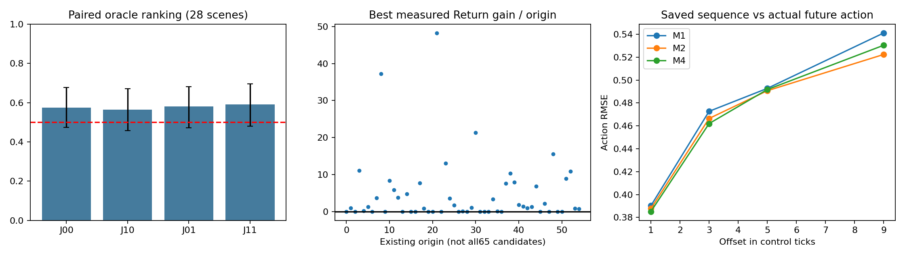

# MPPI失效归因：2026-11-17

结论：**最大可定位误差项是D类：终端延续价值对真实SAC后续收益差的评价失真；G（开环评价与首动作/反馈执行目标不一致）是其次必须处理的协议偏差。** 这不等于已经唯一证明“策略不匹配”是根因，Q泛化、MC噪声和状态缺失尚未完全分离。C存在明显误差但oracle替换未显著修复排序；E会扰动搜索却无收益证据；B不是当前可证实的主因。A不能解释全部退化：已执行子集中存在真实获益候选。F的Mean与Elite均已真实闭环失败。这个排序是证据优先级，不是可识别的因果贡献百分比。

## 1. 版本与真实性核验

当前HEAD：`45073e15f4d38ea53840a4bef22a5bd06e2774a5`（本地main）。56回合记录基础SHA：`ced768831d7c79e16b5e7799dfcc07267ee1a52f`，**SHA不同**，但运行源码指纹均为 `bdae7742d1b69bc3404a41273cc48c7ff582dd4fc02c3fe53ce4b58ac5c800d0`；旧补丁在当前5个规划文件上反向检查成功，当前提交包含在线Elite实现。不是把candidate_audit记录冒充执行。当前main的`best_final_elite`会实际执行最终轮原预测Top1与Baseline公平比较后的首动作。原有trace中E/PE实际source=2，其他方案不使用Elite执行。

Checkpoint：`/home/kzb/kzb_code/tdmpc2/mpr_mpc_v2/logs/metadrive-risk/1/mpr_mpc_v2_1.0_wm200k_rl300k_20261103_195237/models/milestone_500k_full_mpr_mpc.pt`；SHA256 `4d0f1d43749794d1d1c28533309cbe75bc3712d25a92936ca7b477c30014810a`。这是WM200k+RL300k、总500k的既有模型，本轮没有换模型。56个配置逐项记录路径、配置hash、选项、共同源码指纹及checkpoint hash，见experiment_manifest.json。仅有旧基础SHA而非一个原子实验commit；不能给每回合伪造独立commit。

未执行fetch/reset/checkout/commit/push。远端main核验单独见remote_version.json；本地origin/main缓存不能冒充远端最新。

实测`git ls-remote origin refs/heads/main`返回 **`bfe035d7ea441bb845f65d7b72c3e3dbebfb3d33`**，与本地HEAD不同。远端这版local_mppi只有candidate_audit的BestElite记录，**没有在线selection_mode/best_final_elite实现**；在线Elite存在于本地45073e1。56回合应归属本地运行源码，不能归属当前远端main。未擅自同步或覆盖任何分支。

## 2. 数据覆盖及统计

本轮新增277条**历史分支记录的分析行**（197个精确重放分支+4起点×10候选×2干预），不代表新增277次环境执行。同一历史分支可能对应不同分析cohort，不能跨cohort相加当独立样本。197条分支来自28个Fit/InnerStop场景；H10完整oracle有55个起点，27场景存在超过1回报差的有效候选对。另完整分析56回合中48个MPPI回合的全部逐轮动作/Q记录。

真实收益差绝对值≤1固定为近似相等，排序准确率排除这类真实收益对；预测分数相等计0.5。Spearman/Kendall保留原连续收益及原生ties。场景内先平均，再按场景bootstrap2000次、seed1、95%CI；多个起点、种子、时间窗及候选对不当成独立地图。所有旧验证标签均已见，不称为新独立验证。

- fit_innerstop/H10_SAC：测得最佳候选收益增量 4.625 [2.699, 6.977]；起点存在>1正收益比例 50.000 [35.714, 62.500]%。

- fixed_rounds/H10_SAC：测得最佳候选收益增量 7.569 [3.071, 15.180]；起点存在>1正收益比例 100.000 [100.000, 100.000]%。

- fixed_rounds/first_action_SAC：测得最佳候选收益增量 2.847 [0.861, 5.537]；起点存在>1正收益比例 75.000 [25.000, 100.000]%。

- fit_innerstop/H10_SAC/legacy_fixed3_no_full_gaussian_pool标签覆盖 100.000 [100.000, 100.000]%。旧3分支的100%只表示3个固定干预均有标签，不代表整个Gaussian池均有标签。

- fit_innerstop/H10_SAC/saved_gaussian_search_pool标签覆盖 1.550 [1.550, 1.550]%。旧3分支的100%只表示3个固定干预均有标签，不代表整个Gaussian池均有标签。

- fixed_rounds/H10_SAC/saved_gaussian_search_pool标签覆盖 3.831 [3.831, 3.831]%。旧3分支的100%只表示3个固定干预均有标签，不代表整个Gaussian池均有标签。

- fixed_rounds/first_action_SAC/saved_gaussian_search_pool标签覆盖 3.831 [3.831, 3.831]%。旧3分支的100%只表示3个固定干预均有标签，不代表整个Gaussian池均有标签。

**A：存在真实获益候选，但不能证明完整候选池充分覆盖。** candidate_coverage.csv按起点给出正/负/近似相等数量、分母及覆盖；小量已执行候选的oracle是下界。全部Gaussian/Top8的大多数真实收益缺失，不能输出完整池真实SelectionRegret。candidate_ranking.csv中argmax仅为已测子集离线诊断，不冒称原在线动作。actual_selected_counterfactual.csv才是原K=1/2/4选择的实测前缀后果；56回合真实闭环结果另外引用。

## 3. Reward / Dynamics / 延续价值分解

所有J使用相同candidate终端a_H、Q01、gamma=.995、H10与cost=0；真实latent只做离线oracle。按题设J00/J10/J01/J11使用未额外加入预测终止mask的gamma^H公式。H前原生终止保留原始失败及收益，但没有z_H时排除完整oracle，绝不补造未来。完整候选前缀后实际由SAC接管，而a_H未实际执行，故J11仍不是实际策略价值。

| 评分 | 配对准确率% [95%CI] | Spearman | Kendall | Top1 Regret |
|---|---:|---:|---:|---:|
|J00|57.438 [47.376, 67.685]|0.125 [-0.071, 0.304]|0.101 [-0.077, 0.268]|4.904 [2.270, 8.329]|
|J10|56.389 [45.740, 67.069]|0.120 [-0.063, 0.289]|0.095 [-0.065, 0.244]|5.737 [2.517, 9.785]|
|J01|58.056 [47.099, 68.026]|0.148 [-0.038, 0.329]|0.131 [-0.036, 0.292]|6.132 [2.720, 10.525]|
|J11|59.167 [47.900, 69.507]|0.214 [0.037, 0.388]|0.179 [0.024, 0.321]|5.818 [2.328, 10.186]|

- J10相对J00：配对准确率变化 -1.049 [-4.321, 2.160]个百分点；Regret变化 0.833 [-1.145, 3.953]（负值才改善）。

- J01相对J00：配对准确率变化 0.617 [-7.253, 8.890]个百分点；Regret变化 1.229 [-0.855, 3.918]（负值才改善）。

- J11相对J00：配对准确率变化 1.728 [-6.173, 10.372]个百分点；Regret变化 0.915 [-2.882, 5.025]（负值才改善）。

相对Baseline的前缀收益误差MAE：0.389 [0.292, 0.497]；折扣后终端延续收益差误差MAE：8.458 [5.658, 11.645]。分解逐候选保留e_prefix、e_terminal、平方项及交叉项，避免把相关误差平方直接相加当独立贡献。Q在真实末端latent上对实际SAC RTG的配对准确率为 55.833 [44.752, 66.792]%。

**B/D/E回答：** 已测子集原Q识别能力不足，不能稳定提取oracle收益；真实前缀奖励没有恢复总收益排序，真实末端latent也没有显著恢复。真实状态加真实奖励仍保留较大后续价值误差，支持优先检查Q估计/实际延续策略目标，而不支持直接重训Dynamics或继续造ValueHead。不能仅据这些数据断言所有残差都是“策略不匹配”：MC回报噪声、状态/交通上下文和Q泛化同样未被完全隔离。

原Reward自身对真实prefix的有效大差值对准确率约93%，但只有12场景存在>1有效差值，全部场景Spearman约0.17。它既不是“Reward已经精准”的证明，也不能据此宣称全体候选Reward排序可靠。详见表中prefix_reward行。

逐步latent误差及cosine、Reward误差、物理RMSE见rollout_prediction_error.csv / branch_rollout_errors.csv。相对Dynamics方向cosine从H1约0.75降至H10约0.47，H10误差/真实候选差异约1.07，说明C是真问题；但不能由latent距离本身推断排序因果。WM没有物理decoder，XY/航向/速度误差明确标为既有bicycle模型，绝不称为WM位置误差。56回合缺少物理轨迹，不能补造其XY诊断。

## 4. Q Ensemble与搜索分布

枚举全部10双Q组合及五成员均值，在4个原始起点×4轮×65同池候选重评。排名Spearman 0.883 [0.736, 0.972]；Top8 Jaccard 0.667 [0.491, 0.842]；条件单次Mean首动作差 0.013 [0.008, 0.020]；序列RMSE 0.010 [0.006, 0.016]。实际每轮Q成员见actual_q_member_indices.csv及原目录catalog；random_pair确实每轮重抽，且最终评分另抽一对。原生TD-MPC2同样如此，不是Bug证据。

同已有实际标签，ensemble相对预先固定Q01的配对准确率变化 -4.846 [-11.481, 0.587]个百分点，Regret变化 0.227 [-0.687, 1.224]。这是缓存同池比较，不是新闭环；没有独立起点显著改善证据，不推荐固定Q或ensemble在线替换，也不从10对中反向挑最优。

search_distribution_diagnostics.csv记录各轮ValueGap、Entropy、ESS、Baseline入Elite、Mean/Std变化、动作改变量、分维标准差、Elite距离及边界饱和率。**精确裁剪率缺少pre-clamp创新量，不伪造**。跨轮样本是新抽样，索引Top8重合只作index描述，不能冒充同轨迹Jaccard。离线复现使用原逐向量CUDA topk：CPU批量topk在分数相等时会换候选，曾导致诊断assert失败；工具已修复，未改变在线planner。各回合最终Mean已与保存值匹配。

- M1末轮ESS 7.328 [7.316, 7.339]，Entropy 2.011 [2.003, 2.019]，Elite Gap 1.849 [1.428, 2.513]，Baseline入Elite 7.033 [5.308, 8.999]%。

- M2末轮ESS 7.698 [7.670, 7.727]，Entropy 2.052 [2.050, 2.055]，Elite Gap 1.001 [0.792, 1.297]，Baseline入Elite 0.321 [0.210, 0.442]%。

- M4末轮ESS 7.907 [7.888, 7.927]，Entropy 2.072 [2.069, 2.074]，Elite Gap 0.413 [0.360, 0.480]，Baseline入Elite 0.093 [0.000, 0.194]%。

M4末轮ESS约7.91/8，说明Elite权重接近均匀；这不证明全部65候选都同分。distribution_score_separation.csv另外分开给出65候选得分范围/标准差、Top8 Gap及最大权重，避免把Elite内近等权与候选完全无差异混同。它是原beta下的实际行为，不据此擅自调temperature。

## 5. 首动作与真实闭环一致性

- M1实际首动作ΔL2 0.070 [0.070, 0.071]，方向盘|Δ| 0.027 [0.026, 0.028]，油门|Δ| 0.059 [0.058, 0.060]；原计划第9步与真实执行动作RMSE 0.541 [0.512, 0.567]。

- M2实际首动作ΔL2 0.113 [0.109, 0.117]，方向盘|Δ| 0.038 [0.037, 0.040]，油门|Δ| 0.097 [0.093, 0.102]；原计划第9步与真实执行动作RMSE 0.522 [0.486, 0.579]。

- M4实际首动作ΔL2 0.172 [0.168, 0.177]，方向盘|Δ| 0.049 [0.046, 0.053]，油门|Δ| 0.151 [0.146, 0.158]；原计划第9步与真实执行动作RMSE 0.530 [0.479, 0.582]。

- E实际首动作ΔL2 0.139 [0.138, 0.140]，方向盘|Δ| 0.046 [0.045, 0.047]，油门|Δ| 0.117 [0.115, 0.120]；原计划第9步与真实执行动作RMSE 0.520 [0.460, 0.578]。

- PE实际首动作ΔL2 0.137 [0.133, 0.140]，方向盘|Δ| 0.046 [0.044, 0.048]，油门|Δ| 0.115 [0.111, 0.120]；原计划第9步与真实执行动作RMSE 0.532 [0.483, 0.592]。

相同候选在H10前缀→SAC与首动作→SAC两协议下，Spearman=0.079，95%CI[-0.158,0.364]；Top1一致率25%。仅4个已见开发起点，不能直接推广。但这足以否定把H10标签当作首动作控制质量等价标签；首动作→SAC也不等于每步重跑MPPI。replanning_consistency.csv覆盖全部48个真实MPPI回合，后续执行确实偏离原序列。closed_loop_prediction_error.csv的多步latent差同时含动力学误差与重规划动作改变，不能只归因Dynamics。

56回合真实闭环已表明：M1/M2/M4相对B折扣收益约−3.03/−3.02/−6.50，所有六个MPPI定义在两个种子上均负；没有成功率提升，M4新增碰撞，P/E单项加重越界。F中Mean/Elite已做过实际对照而非只审计；均没有正收益。动作修正量非零且随迭代增大，但其有效控制价值尚未被证明。

## 6. 完整规划耗时与缺失阶段

|配置|P50 ms|P95 ms|P99 ms|
|---|---:|---:|---:|
|B|70.51|76.06|80.50|
|E|110.99|114.96|117.36|
|M1|99.53|104.25|108.11|
|M2|111.84|117.10|125.10|
|M4|136.09|140.81|149.30|
|P|113.63|118.43|130.83|
|PE|114.17|118.12|123.40|

上表复用同代码RTX3070、单GPU worker、相同两固定状态的原同步完整agent.act测量，每方案100次；不是并发回合的污染耗时。所有MPPI P95>100ms，M1也未达标。本轮另对缓存z/actions测了WM/Q、采样、Elite更新及局部planner，记录在timing_breakdown.csv；分层同步有额外开销且嵌套阶段不可相加。Lattice/SAC/适配与最终选择独占时间未在旧回合保存，且缓存缺完整几何上下文，明确N/A。未另开MetaDrive伪补原始阶段耗时，也不将历史其他版本profile混用。

单独追加了非侵入PhaseTimings：同缓存origin的M4，每计划累积Reward、Dynamics、Termination、Q、采样及Elite耗时，30次有效测量；并验证插桩前后selected_sequence、全局CPU/CUDA RNG及私有采样RNG完全相同。见cached_phase_profile.json。以下是局部planner每计划的CUDA stream累计阶段，不包含Lattice/SAC，也不应与上表混加：

- mppi_sampling_ms：P50=3.00ms，P95=3.26ms，P99=3.40ms。

- wm_reward_ms：P50=11.56ms，P95=12.24ms，P99=12.61ms。

- wm_dynamics_ms：P50=14.40ms，P95=14.96ms，P99=15.22ms。

- wm_termination_ms：P50=11.08ms，P95=11.84ms，P99=12.20ms。

- q_evaluation_ms：P50=6.07ms，P95=6.55ms，P99=6.91ms。

- elite_update_ms：P50=1.09ms，P95=1.25ms，P99=1.29ms。

## 7. 根因证据排序与下一步门槛

|优先级|因素|证据及限制|
|---|---|---|
|1|D 延续价值/评价目标不足|终端收益差误差远大于prefix；真实Reward+真实latent仍未恢复可靠排序。无法唯一分离策略差异、Q泛化与MC噪声|
|2|G 目标/反馈不一致|同池A/B排序弱、真实执行偏离H10计划；直接协议对照，但只有4起点|
|3|C 相对Dynamics误差|随H扩大且方向恶化；oracle替换无显著收益，暂未证实是主导|
|4|E Q抽样波动|可观测排名/Mean变化，但ensemble无改善，不改默认|
|5|F 分布更新/提取|未发现算法实现错误；Mean/Elite真实闭环都失败，非单一提取方式可解释|
|6|B Reward|有预测误差，替换真实prefix未修复，证据不支持优先改Reward|
|7|A 搜索覆盖不足|有正收益候选，不能解释全部；完整池真实标签缺失，仍不能排除在部分状态覆盖不足|

只保留一个后续方向：**D，核对实际Lattice+SAC延续目标与Q排序的一致性**，并严格分开G中的H10/首动作协议；对应最小代码改动限于本轮离线oracle及独立next_hypothesis.json，不改在线评分/采样/动作选择。预期指标是同起点实际延续收益排序、首动作Regret改善，不能以预测分数上涨验收；若配对开发样本真实收益/Regret无改善就否定方案。当前没有独立改善证据，不进入封存验证，不启动正式100场。无法从本诊断直接导出已验证的在线修复，也不训练第六个评分头。

交付问题A—H逐项回答：

|问题|回答|
|---|---|
|A 搜索空间有真实好候选吗|有：已测子集约32.4%候选为正收益，约一半起点至少有一个>1收益候选；完整Gaussian池标签不足|
|B 原Q识别得出来吗|不可靠：J00配对准确率57.4%，CI跨50%；已测子集最优平均+4.63，Q所选平均约−0.28|
|C Q成员影响排名吗|影响：Top8 Jaccard约0.67；但ensemble没有改善真实排序，不能据此改默认|
|D 真实latent能恢复吗|未证实：58.1%，配对变化+0.62pp且CI跨0，Regret未改善|
|E 真实Reward能恢复吗|未证实：56.4%，配对变化−1.05pp且CI跨0，Regret未改善|
|F 有SAC后续策略不匹配迹象吗|有：真实latent的Q对SAC RTG约55.8%，终端收益差误差显著更大；但与Q泛化/MC噪声不能唯一分离|
|G 首动作改变多少、有用吗|ΔL2约0.070/0.113/0.172（K1/2/4），控制改变真实存在；闭环折扣收益均下降，未证明有效收益|
|H 最大可定位解释项|终端延续价值差误差MAE8.46，对比prefix0.39；优先D，G为协议层第二瓶颈。不是已识别的唯一因果比例|

## 8. 修改、测试及可复核性

新增tools/mppi_failure_attribution.py（离线统计）、tests/test_mppi_failure_attribution.py（3项关键回归）及本目录run.py/summarize.py/profile_cached.py。未改任何已有规划/网络/训练/配置文件，原56项相关测试保留，与新增3项共59项通过，详见tests.txt。checkpoint、535输入、动作映射、Cost Validator、cost_weight=0、Gaussian/AR、64/8/4、std/rho/temperature与默认在线选择均未修改。

主要可复核数据：experiment_manifest.json、candidate_returns.csv、candidate_ranking.csv、candidate_coverage.csv、q_ensemble_rank_stability.csv、rollout_prediction_error.csv、search_distribution_diagnostics.csv、timing_breakdown.csv、paired_statistics.json、verification.json。全部输出到新目录；旧实验结果原样保留。两个工具开发失败日志保留：旧Checkpoint验证buffer加载需复用原加载器；CPU/GPU topk ties需按原CUDA操作复现。两者均未执行环境、改权重或影响历史结果。

