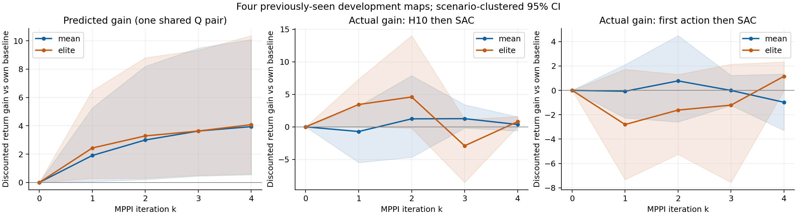
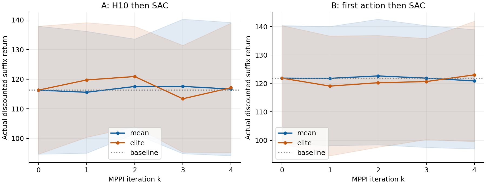
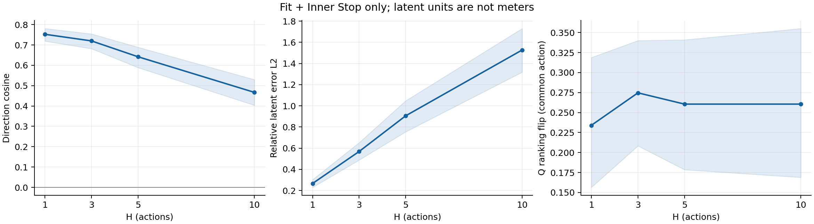
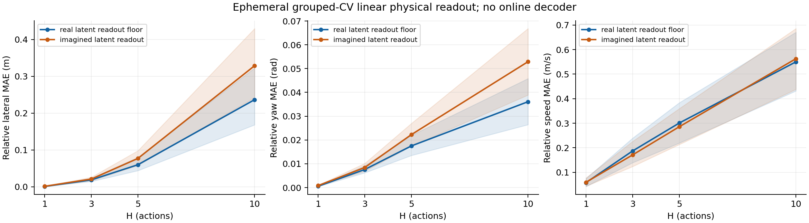
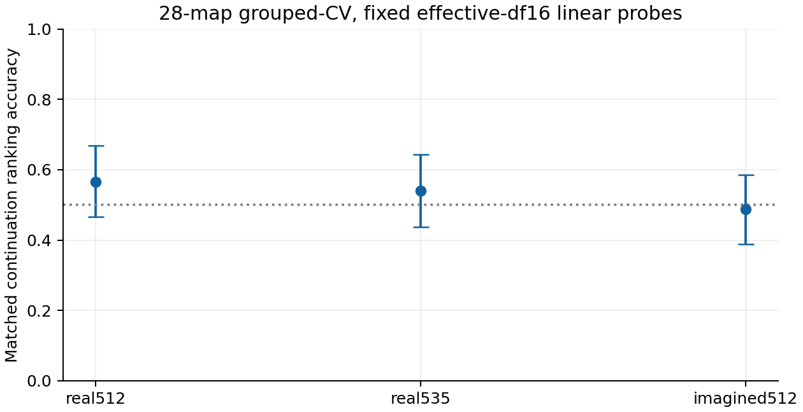

# MPPI退化诊断：迭代、相对Dynamics与SAC状态信息

基线 `bfe035d7ea441bb845f65d7b72c3e3dbebfb3d33`，开始时工作区干净。只做针对性诊断及独立iterations配置；不训练第六个价值头、不改WM/Q/SAC/Lattice权重或535维定义，不改Reward/gamma/done、Cost及在线选择默认。原checkpoint SHA256 `4d0f1d43749794d1d1c28533309cbe75bc3712d25a92936ca7b477c30014810a`。没有commit/push/reset。

## 结论先行

**目前最明确的问题是评价协议与执行目标错位，尚不能唯一证明完整闭环退化的主因。** H10开环与首动作干预的同池真实收益Spearman仅0.079；它们不是可互换的训练标签。原Mean的真实收益没有随迭代单调下降，不能硬定义为“所有迭代持续放大模型错误”；但4轮相对1轮的首动作干预Mean实际收益下降、预测收益上升，是有限开发样本上的后期过度乐观证据。

Relative Dynamics误差随H积累，但把真实latent交给同一个Q没有得到可靠的排序修复证据。真实535维低容量评价器也没有胜过真实512维，因而不支持盲目增加输入或更宽MLP。下一阶段只建议**对齐真实逐步重规划执行协议的少量1/2/4迭代消融**，不选开发集赢家修改默认，不训练新的评分器/Dynamics适配器，不启动正式100场。

## 数据、执行协议和可复现性

4个诊断开发起点为[[64377, 50], [63946, 150], [64391, 50], [62322, 150]]，按原Fit列表位置预先固定，未按实际Return挑选；它们是已见开发地图，不是独立测试。每个起点固定Baseline、第一条Gaussian以及四轮各自Top1 Elite和Mean，共10候选；A/B两种干预，共80条原生终止分支。另对Fit+InnerStop原197条分支只重放H前缀，取得真实H末端535维状态；28张地图、55个起点，全部197条可构造原生非终止H状态。没有调用已使用验证场景做模型/方案选择。

先完整重建缓存4×64 Gaussian和当轮分数，均逐项一致，再冻结10条候选，之后才采真实后缀。观察、车辆/交通、可记录Python/NumPy/Torch/CUDA RNG、环境配置和候选同起点严格匹配；不宣称完整隐藏Bullet快照。12条重叠原生分支的全部动作、Reward、观测数组与旧实验精确相等，见native_replay_verification.json。提前终止保留，不补造未来状态。

A：执行整条H10前缀，再由原冻结Lattice+SAC接管到原生终止。B：只执行第一个候选动作，随后原SAC逐步反馈到原生终止。**B不是每步重跑MPPI。** Baseline_A本身是10步固定计划，Baseline_B则逐步由SAC反馈，所以两种协议也分别使用自己的Baseline。标签均为真实info[tdmpc2_reward]、gamma=.995和原生done；Episode Return是干预起点后的真实后缀。

代码检查发现planning/trajectory_adapter.py的未来动作来自理想路径上的虚拟状态，而不是实际后继观测；真实部署只执行selected_sequence[0]再重新规划。这进一步说明H步固定计划的后果不等于首动作滚动决策后果。MetaDrive安装源码明确vehicle.speed是m/s，与path.s_d一致，本轮没有发现m/s与km/h混用证据。

## 1. 逐轮预测与真实收益

Gaussian64、Elite8、AR(1)、std/rho、Q聚合random_pair、beta=.5、checkpoint均保持；没有新规则过滤。Top1从原65候选（Baseline+64实际Gaussian）按该轮原始评分取出，可能就是Baseline；没有用真实Return挑Elite。曲线统一以同一个已捕获随机Q对复评，不能跨轮直接比较原始随机Q的分数。每轮原始Q对、Top8索引和原始增益也保留。





|k|Mean预测增益|Mean实际增益A|Mean实际增益B|Elite预测增益|Elite实际增益A|Elite实际增益B|
|---|---:|---:|---:|---:|---:|---:|
|0|0.000|0.000|0.000|0.000|0.000|0.000|
|1|1.904|-0.721|-0.077|2.432|3.431|-2.805|
|2|2.996|1.229|0.774|3.286|4.589|-1.621|
|3|3.628|1.259|-0.011|3.628|-2.915|-1.214|
|4|3.939|0.360|-0.981|4.081|0.795|1.151|

4−1轮Mean：统一参考预测增益增加2.035 [0.396,4.737]；A真实变化+1.081 [−3.471,6.822]；B真实变化−0.904 [−1.188,−0.498]。后者是同4张开发地图的配对证据，**没有独立地图或实际滚动MPPI验证，不能据此改默认为1轮**。Mean在第2轮先改善，第4轮回落；Elite在A/B下方向也不同，所以没有得到全曲线单调退化的证据。

只执行了各轮Top1/Mean/Baseline，不能报告64候选或全部8个Elite的真实排序准确率。这里的Elite Ranking Accuracy明确定义为已执行Top1与Baseline的方向准确率，|实际收益差|<=1的对记为无可判方向；原始当轮Q和共同参考Q两种版本都记录。

|轮数|Elite原始评分方向准确率A|共同参考准确率A|原始准确率B|共同参考准确率B|
|---|---:|---:|---:|---:|
|1|75.0 [25.0, 100.0]|75.0 [25.0, 100.0]|50.0 [0.0, 100.0]|50.0 [0.0, 100.0]|
|2|100.0 [100.0, 100.0]|100.0 [100.0, 100.0]|33.3 [0.0, 100.0]|33.3 [0.0, 100.0]|
|3|33.3 [0.0, 100.0]|33.3 [0.0, 100.0]|75.0 [25.0, 100.0]|75.0 [25.0, 100.0]|
|4|100.0 [100.0, 100.0]|100.0 [100.0, 100.0]|100.0 [100.0, 100.0]|100.0 [100.0, 100.0]|

表中100% [100%,100%]是少量条件样本全正确导致的bootstrap退化，不是总体排序已可靠的证明。

### 独立iterations=1/2/4配置的真实分支结果

重新从同一初始全局RNG和私有Gaussian种子运行1/2/4轮原规划器，除iterations外不变。各轮最终Mean与4轮轨迹中对应Mean完全一致；按该规划器真实Baseline/Mean选择映射到已实际执行分支，没有“选实际收益最高者”。random_pair规则固定，但不同长度计划的最终Q抽样位置本来不同；统一参考曲线另行控制了这个差异。

|协议|iterations|实际折扣Return|相对Baseline增益|Success%|Crash%|OOR%|Route%|
|---|---:|---:|---:|---:|---:|---:|---:|
|A|1|115.576|-0.721|50.0|25.0|50.0|79.3|
|A|2|117.525|1.229|75.0|25.0|25.0|95.7|
|A|4|116.657|0.360|50.0|25.0|50.0|81.0|
|B|1|121.792|-0.077|50.0|25.0|50.0|79.1|
|B|2|122.642|0.774|50.0|25.0|50.0|81.1|
|B|4|120.888|-0.981|50.0|25.0|50.0|80.3|

完整配对Return、事故差及CI在iteration_results.json/paired_iterations；转向/油门首动作改变量及H序列RMSE、每个候选实际Crash/OOR/Route在iteration_curves.csv。所有CI按地图bootstrap2000次，不将40候选或80分支当80张地图；4张地图CI非常有限，没有多重比较校正。

## 2. H10标签与首动作标签不一致

同一起点同一10候选：Spearman 0.079 [-0.158, 0.364]，Kendall 0.089 [-0.044, 0.311]，仅保留A/B两边真实收益差都>1的可判对后，方向一致率 67.3 [49.5, 88.8]，Top1一致率 25.0 [0.0, 75.0]。原始排名相关很低，但排除近似相等后并非全部反序，且样本很少。

Mean4相对自身Baseline在A为+0.360，在B为−0.981；A/B的Baseline平均Return分别116.297/121.868。仅改变接管时刻就会改变候选评价。已有6张验证地图中的Mean−12.03不被用于强迫本轮4张开发地图曲线下降，它们是不同地图和统计集合。

**结论：H10标签不能直接当在线首动作决策质量的标签。** 这并不证明B就是闭环MPPI标签；还缺每一步真正重新运行MPPI的反馈证据。不得以本轮B指标声称D组成功率改善。

## 3. 相对Dynamics与Q排序的受控分解

在Fit+InnerStop每个真实同起点配对，计算(z_predA−z_predB)−(z_realA−z_realB)，每个H有142个非Baseline比较，来自28张地图；不是568个独立场景。零真实变化的cosine无定义，不填成安全/正确。误差与真实收益差的场景内Spearman、动作RMSE分层、逐对向量和Q成员结果均保留。



|H|方向余弦 [CI]|相对误差L2 [CI]|误差/真实变化L2|反向比例%|Q翻转率%（同动作）|
|---|---:|---:|---:|---:|---:|
|1|0.752 [0.719, 0.781]|0.267 [0.230, 0.304]|0.663|0.0|23.4|
|3|0.720 [0.682, 0.755]|0.569 [0.489, 0.653]|0.715|0.0|27.5|
|5|0.642 [0.589, 0.689]|0.906 [0.755, 1.049]|0.787|2.1|26.1|
|10|0.467 [0.403, 0.530]|1.527 [1.318, 1.730]|1.068|4.9|26.1|

相对预测随H变差：H10方向平均余弦约0.467、L2误差1.527、误差/真实变化约1.07；但只有约4.9%是整体反向，不能把所有误差说成方向全错。同末端动作的Q排序约26%翻转，候选自身a_h和共同Baseline动作两种读出均记录；离线全5Q均值/固定pair01仅作诊断，没有改变在线random_pair。

为避免“Q翻转必然改善真实排序”的错误推断，另固定真实prefix奖励、同一冻结Q和候选末端动作，仅替换预测/真实latent。H10真实Return方向正确率从55.6%到61.6%，配对改善+6.1个百分点 [−3.9,+16.1]，CI跨0。真实latent既修复部分排序，也破坏部分原本正确的排序；明细latent_replacement_repairs/harms见JSON。h<10标签仍含后续固定前缀，不冒充纯SAC状态价值。

**结论：Dynamics有累积误差，但还不能证明它解释了主要收益排序退化。** 原Q延续策略/候选a_H和真实SAC延续不一致的问题仍在；把真实状态交给原Q并不能自动保证正确。

### 车辆位移、航向和速度：分别解释模型来源

原WM没有位置/速度解码器，不能把512维L2解释成米。现有kinematic bicycle的直接物理误差单列kinematic_errors.png与relative_dynamics.json；它使用原参数，不把max_acceleration=4/max_deceleration=6宣称为已校准真实界限。

为获得WM可解释物理诊断，另用同28张Fit+Inner地图、同5折、固定effective_df16的临时线性读出，将真实相对latent映射到真实相对横向位移/航向/速度，再把同一读出作用于预测latent。读出只用训练折定标和回归，不保存模型或送在线；必须同时报告真实latent的解码误差底线。横向为初始车体坐标，非未声明的Frenet坐标。



|H|横向MAE：真实/预测latent(m)|航向MAE：真实/预测latent(rad)|速度MAE：真实/预测latent(m/s)|
|---|---:|---:|---:|
|1|0.001/0.001|0.001/0.001|0.058/0.059|
|3|0.019/0.021|0.008/0.008|0.187/0.171|
|5|0.060/0.077|0.017/0.022|0.301/0.286|
|10|0.237/0.329|0.036/0.053|0.550/0.563|

H10预测latent较真实latent的读出误差增加：横向0.092m [0.060,0.127]、航向0.0168rad [0.0112,0.0230]、速度0.0128m/s [−0.0420,0.0625]。这支持横向/航向相对预测误差积累，但读出本身也有误差，不是直接解码出的精确WM车辆轨迹，更不是安全证书。协议中记录了在分析前固定该物理读出设计的补充说明，没有用验证地图挑读出超参。

## 4. 真实512、真实535、预测512的信息对比

真实535由原ResidualStateBuilder在实际H末端观测上生成；所有197条逐步观测、真实Reward与原文件精确一致。535结构为512 latent +12路径特征 +1粗轨迹WM Return +2可行性/回退 +8风险值/有效位，风险顺序cumulative_cost、min_ttc、min_clearance、boundary_margin。Cost值和有效位保持原掩码；没有把真实未来535作为在线输入。

评价器是同容量effective_df16的线性差分ridge，λ仅由训练X谱决定，不用测试Return或旧验证调参；按地图预定5折，训练折独立标准化。标签为同一实际SAC H后延续RTG(.995)，同起点差分。所有模型只在Fit+Inner28地图做out-of-fold预测，没有早停地图反复选择；系数临时使用，不生成.pt文件或第六个Value Head。真实prefix+预测延续的总排序也另记。



|输入|排序准确率% [CI]|Spearman [CI]|Top1 Regret [CI]|收益差MAE|
|---|---:|---:|---:|---:|
|real512|56.6 [46.6, 66.8]|0.133 [-0.056, 0.329]|2.861 [1.862, 3.958]|9.745|
|real535|54.1 [43.8, 64.3]|0.091 [-0.097, 0.287]|3.556 [2.058, 5.598]|9.635|
|imagined512|48.7 [38.9, 58.5]|0.025 [-0.154, 0.202]|6.267 [2.965, 10.166]|10.318|

真实535−真实512的配对准确率差为−2.58个百分点 [−6.97,+0.32]，没有缺失23维导致排序退化的正向证据。两种真实状态的排序率下界均未超过50%；这只是所用低容量评价器不能稳定泛化，不能证明表示在信息论上不足，也不能据此继续堆维度。

原actor的离线零块敏感性（归一化残差动作范数差）说明额外特征被使用，但不证明能预测长时域回报：

|特征块|动作变化中位数|P95|
|---|---:|---:|
|path|0.534|1.841|
|wm_return|0.201|0.671|
|feasibility|0.078|0.365|
|risk|0.327|1.836|

真实535去掉path/wm_return/feasibility/risk的同容量out-of-fold比较见state_information.json；没有稳定的整体535排序优势，故本轮不宣称某个额外特征是价值缺失主因、不新增预测规划上下文网络。零块是离线敏感性检查，可能离开训练分布，不是驾驶因果消融。

## 5. 分布审计：纠正“早停没有失败”的统计口径

|集合|地图/起点/分支|完整Crash/OOR|仅新增Crash/OOR|
|---|---:|---:|---:|
|Fit|20/40/144|20/23|12/11|
|InnerStop|8/15/53|4/10|0/0|
|SeenValidation|6/12/48|6/16|6/16|

**11/0次OOR属于新增96/32条，不属于完整144/53条。完整Fit有23条OOR、InnerStop有10条，不能以“53条早停全无失败”解释训练分离。** 新增早停批次确实全成功，批次、候选种类和地图特征仍有分布差异；应分开审计。SeenValidation仅作已见数据描述，不能再次当封存独立验证。

速度、局部参考曲率proxy、交通对象数proxy、道路类型、候选动作RMSE、真实收益差，以及预定5折训练/测试各自事故分布均在distribution.json。traffic_count不是vehicles/km，heading-change/10m也不等于完整地图曲率。按地图重采样，不把同起点多个候选当独立地图。

next_collection_strategy.json只提出策略、没有执行新采集：用Fit+Inner起点特征的预定分位切点和道路类别，遍历固定打乱的新场景池，在固定step25/50/100/150/250填充不足的可见状态分层；不看未来Return/Crash/OOR选样，先按地图划分角色，不提高同一轨迹滑窗密度，不用SeenValidation定阈值。这是数据审计交付，不是同时启动新的适配方案。

## 6. 归因优先级与唯一下一方向

1. **先对齐执行与评价协议。** A/B同池排序差异由真实原生执行确认；当前H10标签与在线首动作/反馈决策定义不一致。已有Mean后期预测提高但首动作实际收益下降的开发证据，足够安排少量真实重规划核验，不足选择线上迭代数。

2. **Dynamics列为次级待隔离因素。** 相对误差及横向/航向读出误差累积，但真实latent替换的Q排序修复未有可靠正增益，不能跳过协议问题直接训练适配器。

3. **暂不支持“535信息缺失是主因”。** Actor使用额外特征，然而同容量535排序未胜512；真实状态也未稳定排序。优先检查反馈策略、候选覆盖和标签信噪比，不再增加同类MLP。尚未做同起点多RNG重复，不能把所有误差归因于随机噪声。

这些受控诊断不能相加为全闭环退化的百分比因果贡献。没有唯一证明线上D组失败的全部根因；没有真实逐步MPPI重规划结果，也没有证明新价值网络有部署价值。

唯一主代码增量为planning/mppi_ablation.py新增iterations_ablation_config：深拷贝原配置，仅改iterations=1/2/4；不改64/8、AR(1)、Q聚合、beta、std/rho、Cost和默认选择。独立消融使用方式：

```python
from planning.mppi_ablation import iterations_ablation_config
options = iterations_ablation_config(cfg.mpr_mpc["mppi"], 1)  # or2/4; explicit experiment only
```

下一阶段只做**新地图、预先固定起点上的真正逐步重规划B对D(iterations1/2/4)小规模核验**，衡量相同协议下真实Return/Success/Crash/OOR/Route和规划耗时。不是再训练Value Head，也不是同时实现Dynamics适配或规划上下文模块。当前默认仍4轮，没有因为开发集第2轮点估计最高就选择2轮。

**不具备直接重跑正式100场或宣称MPPI优于B的证据。** 有理由先做上述少量协议对齐核验；本轮未启动它，也未训练任何新在线网络。

## 文件与检查

- planning/mppi_ablation.py：仅新增独立迭代配置工厂。
- tools/mppi_diagnosis.py：相对误差、场景fold及固定容量线性诊断数学，不连接在线选择。
- tests/test_mppi_diagnosis.py：3个针对性回归，原50项断言/文件保留。
- reports/mppi_root_cause_20261117/：预定protocol、缓存重建、80分支、197前缀状态、交叉验证/相对误差/物理读出、分布、CSV和6幅图。

**53 passed (original50 retained +3)**；原checkpoint、原模型/输入/映射/Lattice/默认config和Cost Validator均校验保持。没有新.pt文件，原数据/模型和旧报告未覆盖。实验采样源码快照与最后增加的无默认副作用配置工厂分开记录。完整Diff见code_changes.patch，结果/完整性见verification.json。
