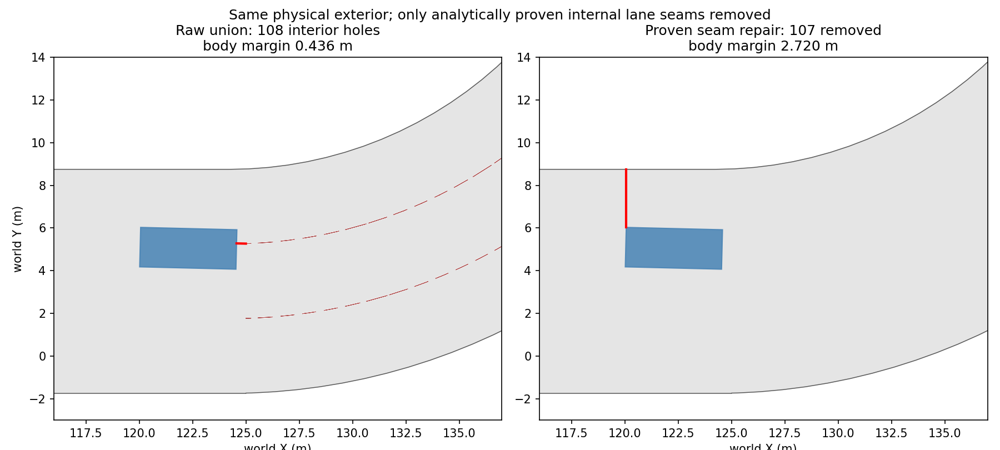

# 第三轮：Recovery 统一评分与主动安全修正

本轮以用户指定的 `main@6b8271dc9e4e87f39e87f0caca383eab4eac78b6` 为起点，启动时工作区干净。代码已实施并回归；**559 的 120 步脱困验收通过，当前 main 的正常驾驶回归及 5 个额外场景通过。历史 1714 数值的 98% 目标仍未恢复，因此默认正式 100 场 B/D 入口保持关闭。**

没有训练 WM/SAC、修改网络/535 维特征顺序/Action Mapping/模型权重；没有改 Lattice 轨迹生成、训练阶段、1000 步上限、MetaDrive 碰撞/越界/成功判定；没有 reset、checkout、clean、commit 或 push。

## 1. 修改文件

| 文件 | 修改内容与原因 |
|---|---|
| `planning/local_mppi.py` | Normal/Recovery 评分语境分离；统一恢复参考和有界动作质量项；精确可行候选的分层/Pareto 排序；实测边界趋势；有实效的恢复延续；16 条受控候选中的转向-滑行/减速组合；进度不足回退的明确诊断。 |
| `planning/mppi_safety.py` | 增加完整时域/近端/终点车身裕度与变化、双模型拒绝和首次失败区间诊断；改进车头尺度前视及道路切线建议；修补经解析车道几何严格证明的内部拼接缝，并缓存结果。 |
| `planning/safety.py` | 仅给 SafetyContext 增加 source_lanes 溯源元数据并在构建上下文时传递；原道路多边形和 SAC 风险特征计算不改。只有知道原 union 的贡献车道，MPPI 才能证明补缝，避免拿全地图其他道路作为错误证据。 |
| `tests/test_trajectory_selection.py` | 保留全部原有测试，在现有文件扩展 24 个参数化用例：评分、统一参考、裕度、延续、实测触发、镜像符号、无进度回退、耦合候选、内部细缝证明与真实边界/碰撞保持。 |
| `tools/smoke_v32_recovery.py` | 记录每步 SAC/Lattice/最终动作与几何提示；记录车道几何溯源、前方障碍物、补缝数量、真实物理步和规划尝试、证书与逐候选评分归档。 |
| `tools/run_trajectory_pair.sh` | 正式 B/D 入口改为读取本轮验收及源码/权重指纹。主模型单独校准和 233ms 时延不作为独立门槛；历史进度条件尚未满足时保留关闭。 |

`config.yaml`、Cost 验证机制、`allow_unvalidated_cost=false` 和未通过的 `motion_calibration_final/validation.json` 均未修改。Normal 仍使用 64 samples / 8 elites / 4 iterations；Recovery Lattice 仍为 32 samples / 2 iterations；Controlled Recovery 最多 16 条。参考预检查与后续检查复用同一候选和缓存，没有扩大受控候选池。

## 2. 关键根因：内部车道拼接细缝被当成真实道路边界

只修改评分和候选形状时，559 仍反复制动并提前安全终止。进一步查看道路轮廓发现：MetaDrive 的 `CircularLane.polygon` 按固定 **1m 纵向距离**采样，相邻圆弧半径不同，于是共享车道边缘使用不同角度的弦。union 后产生毫米级内部细缝，车身扫掠与负 road_margin 缓冲会将其当成不可跨越的道路孔洞。

这既污染了精确可行性判断，也污染了边界裕度和恢复排序。559 前方约 0.436m 的“边界”实际是内部拼接缝，不能据此认定车辆已经面对真实路缘或不可恢复死角。此前只根据最近边界的位置作出的“前方几何危险”解释被本次解析车道核查纠正。

补缝不使用任意面积过滤或 buffer close，而要求：

- 车道来自构建该道路 union 的原始 `source_lanes`，类型必须是已知的 `CircularLane`，且非 forbidden。
- 两条源车道具有相同圆心、方向和角域，半径与宽度证明它们共享内部边缘，没有径向中央隔离带。
- 孔洞的整个凸包落在真实解析环形扇区内，并位于实际采样步长推导出的弦高误差带中。
- 只允许约 64 个 float64 ULP 的运算舍入界（本地图约 1e-12m），不是新增的毫米级道路容忍度。
- 只移除被证明的内部孔洞；不改外轮廓，不删除无法证明的孔洞、真实隔离区或未知车道类型。

559 初始道路有 108 个孔洞，证明并移除 107 个，保留 1 个；填回面积 0.279976m²，**外轮廓完全相同**。实际车身对真实外边界的裕度约 2.720m，原始含缝几何却报 0.436m。



所有原碰撞、连续扫掠、车辆尺寸、运动学和 road_margin 检查继续执行；Center AND Legacy 都使用经过证明的同一可行驶区域。SAC 的源道路多边形对象与特征值保持不变，单元测试检查源 WKB 未被改动。没有把运动学模型检查通过称作真实环境安全保证。

## 3. 修改前后评分公式

令 `V=discounted reward + discounted terminal Q`，`C` 只有在原有候选排序验证通过时才计入，`R` 为原长时域风险。所有评分项均保留原权重，尤其 `deviation_coef=1.0`、`smoothness_coef=0.3`，没有通过将偏离权重调零绕过问题。

**原实现及保留的 Normal：**

```text
D_SAC = mean[(delta_steer/b_steer)^2 + 0.25*(delta_throttle/b_throttle)^2]
M_N   = mean ||diff(action - SAC_baseline)||²
S_N   = V - validated_cost_penalty - lambda_dev*D_SAC
          - lambda_smooth*M_N - lambda_risk*R
```

Normal 继续围绕 SAC 单高斯搜索，保留原 baseline 替换改善阈值。真实安全、正常进度与裕度足够时，不启用恢复参考或改 SAC 行为。

**新的 Recovery：**

```text
rho(q) = q/(1+q)
D_ref  = mean rho(((action - recovery_reference)/recovery_bounds)^2)
D_SAC  = mean rho(((action - SAC_baseline)/normal_bounds)^2)
M_R    = mean ||diff(action)||²
U_0    = mean rho(((first_action - actual_previous_action)/control_step_bounds)^2)
S_R    = V - validated_cost_penalty - lambda_dev*(D_ref + D_SAC)
          - lambda_smooth*(M_R + U_0) - lambda_risk*R
```

`D_ref`、`D_SAC` 各在 [0,1]，所以不会再产生 104 分的 SAC 偏离惩罚。Steering 连续性仍受实际转向速率约束，Throttle 仍沿用独立制动释放/增减油门规则；评分里的连续性不能替代这些约束。

Recovery 的唯一参考优先取完整验证通过的 Lattice，否则从经过精确检查、具备合理进度的几何候选选择；只有实测改善并验证动作一致的上一条恢复轨迹才可能作为延续候选。无几何候选时仅能使用另行精确验证的正常候选或可恢复 Lattice，不能把未验证参考当作执行凭证。

进入 Recovery 后，Lattice、Controlled 和参与最终比较的 Normal 候选全部针对该参考、同一 bounds、同一 WM/Cost/风险计算重评分。正常阶段旧分数不与恢复阶段新分数直接比较，最终选中分数、连续性调整后的分数和归档分数保持一致。

## 4. Recovery 排序与边界趋势

排序层级为：

1. 原精确安全检查与同前缀可恢复性。预筛选结果不能授权执行。
2. 合理正向进度。恢复可以使用既有保留比例评价直线可达进度，不要求转向恢复同时达到最大预测速度；零进度只可作为明确标记的安全回退。
3. 按车辆尺寸/可用车道宽度归一化的几何层级：先比较终点横向误差和终点车身边界裕度的 epsilon-Pareto 层；再比较近端/全时域最小车身裕度、裕度趋势、已提交段横向误差、障碍物距离和未来风险。epsilon 来自原 model_margin/数值扫掠分辨率，小于模型分辨能力的变化不会获得绝对优先级。
4. 在几何可比候选中再比较统一 WM/驾驶质量评分。未显著改善横向误差的可行候选仍保留在后续层，不会因为一个横向改善比例被硬性删除。

`tail_risk()` 不再仅有 road/collision/kinematic 的区间比例，还包含归一化的车身裕度和障碍物间距。米制裕度不直接与二值越界混作同一种量；硬安全判断始终先于这些排序量。

主动边界干预使用连续 3 个实际控制观测：车身裕度连续下降、车辆相对可用车道宽度已接近外侧、路线前进不足且没有向内改善时进入恢复。道路作用域/宽度变化时清空趋势，正常弯道、合理换道不会仅因曲率或 full_valid=False 触发。退出仍需持续的实际速度/路线进展与边界改善迟滞。

上一条恢复轨迹只有在精确验证通过、实际动作匹配、横向/边界不恶化且有合理实际路线前进时才允许移位延续。侧向抖动不算路线前进。没有安全动作时继续原 P0 safety_failure，不会为脱困强制正油门。

16 条候选保留保持转向、道路切线、几何向内、Lattice 引导、不同变化速率与有效延续；增加向内后回到道路切线的时变形状，并以少量转向＋滑行/减速替换重复正油门组合。所有新序列经过同一检查，没有新增规划器或控制网络。

## 5. 转向符号和诊断

左右镜像直道（世界航向 0/π）及镜像弯道测试通过。MetaDrive 实际 `_set_action` 仍直接使用 normalized steering × max_steering；没有给所有 steering 取反。实际回放的正负转向/航向响应与模型方向一致，短暂轮胎响应偏差仍记录为执行误差。

原轴距前视在低速下可能落在车头附近，因此恢复提示改用车头半长＋轴距的几何尺度，并同时提供未来道路切线方向，避免把“最近车道中心”当作所有弯道的唯一正确恢复方向。

逐候选归档包含 WM Value、Reward、Terminal Q、SAC/恢复参考偏离、平滑度、首动作连续性、边界风险、横向改善、路线进度、最终分数、拒绝原因、选中排名、双模型拒绝原因、制动延续和首次失败区间。模型默认 substeps=2，实际物理 tick=0.02s，因此首次失败物理 tick 标为**区间上界**，没有伪造精确的实际碰撞时刻。拒绝原因区分近端道路失败、远期可恢复性失败、进度不足、几何层级和 WM 分数问题。

最终选中分数与归档分数最大绝对差 0.00001760（float32/host 运算舍入），测试阈值 1e-3。完整实际分布保存在 `reports/round3/scoring_audit.json`。

## 6. 单元测试

`/home/kzb/anaconda3/envs/tdmpc2/bin/python -m pytest tests -q --disable-warnings --junitxml=reports/round3/unit_tests_final_passed.xml`

**349 passed，0 failures，0 errors**。原始 325 项测试全部保留，扩展 24 个参数化用例。覆盖统一参考、有界惩罚、几何优先级、时域中间裕度下降、无进度回退、实效延续、边界趋势、镜像转向、受控转向减速、真实碰撞/外边界/隔离区保持、未知车道不补缝，以及原 SAC 几何不被修改。`git diff --check`、脚本语法及完整补丁反向校验另行通过。

## 7. 559：严格 120 步回放

| 指标 | 修改前当前 main | 本轮定稿 | 要求 |
|---|---:|---:|---:|
| 实际控制步/规划尝试 | 10/11 | 120/120 | 120 个真实控制步 |
| 平均速度 m/s | 0.413 | 8.007 | ≥0.5 |
| 最高速度 m/s | 1.064 | 15.467 | 记录 |
| 路线增量 | 0.001322 | 0.391251 | ≥0.01 |
| 低速步数 <0.3m/s | 6/10 | 1/120 | ≤20 |
| Emergency 执行步 | 3 | 0 | ≤10 |
| 未验证动作执行 | 0 | 0 | 0 |
| Safety Failure | 1 | 0 | 0 |
| Crash / Out of Road | 0/0（提前终止） | 0/0 | 0/0 |

本轮 559 各项固定步数条件通过。修改前只执行 10 步，不能把其平均值与 120 步当作等长统计检验；本轮没有截断后补零或把提前终止算成功。只改评分、尚未补缝时的试验仍提前失败，说明**修复几何误拒绝是主要进展，不能把整段提升全部归因于 Recovery 评分**。

## 8. 1714：正常驾驶保持与基准差异

执行 60/60 步，无 Crash、Out of Road、Safety Failure、Emergency 或未验证动作，Recovery 步数为 0。平均速度 4.341m/s，路线增量 0.064408074。

| 参考 | 参考路线增量 | 本轮保持率 | 98% 条件 |
|---|---:|---:|---|
| 任务指定当前 main（本轮修改前） | 0.064537146 | 99.80% | 通过 |
| prompt 同时引用的更早历史版本 | 0.066981243 | 96.16% | 尚未通过 |

没有通过切换参考值把历史 96.16% 写成历史达标。当前 main 的增量回归通过，但历史目标仍保留为默认正式门控中的阻塞项；没有为单一场景强制加速或改 Normal 权重。

## 9. 五个额外固定场景（另含一处曲线入口状态）

| 场景/记录前状态 | 覆盖重点 | 真步数 | 路线增量 | 均速 m/s | 最小实测裕度 m | 恢复步数 | Safety Failure/Crash/OOR/未验证执行 |
|---|---|---:|---:|---:|---:|---:|---|
| 694 / 30 | 正常直行 | 60/60 | 0.210002 | 13.051 | 3.695 | 0 | 0/0/0/0 |
| 420 / 200 | 高速与前方障碍、真实恢复 | 60/60 | 0.196096 | 12.866 | 1.008 | 11 | 0/0/0/0 |
| 1084 / 1 | 干净 reset 的正常启动 | 60/60 | 0.200992 | 6.860 | 2.743 | 0 | 0/0/0/0 |
| 808 / 200 | 真实外边界附近、前方车辆 | 60/60 | 0.114971 | 7.587 | 0.169 | 0 | 0/0/0/0 |
| 822 / 100 | 原低速停滞状态 | 60/60 | 0.109985 | 7.087 | 3.164 | 0 | 0/0/0/0 |
| 822 / 30 | 连续弯道入口 | 60/60 | 0.152099 | 9.353 | 2.314 | 0 | 0/0/0/0 |

全部五个额外场景均完成预定真实控制步、产生正向路线进度且无事故或未验证执行；822 的两个不同初始状态用于同时覆盖曲线与低速状态，不当作两个独立场景计算成功率。808 的真实边界裕度最低约 0.169m，仍通过原几何安全标准。Normal-only 用例在最后恢复排序补全时不调用被改分支；实际调用 Recovery 的 559/420 已用定稿重跑。

初次批量重放在 1084 第 300 步初始化出现 0.0110856m/s 的速度偏差，该尝试不计入结果，也没有放宽 1e-4 的重放阈值。最终 1084 用同一 seed 的干净 reset 作为泛化启动用例。核心 559/1714 仍严格使用指定的原始记录前缀。每个最终用例单独进程，避免把不同批次交通历史当作逐位相同状态。

## 10. 完整规划耗时

| 用例 | 均值 ms | P50 ms | P95 ms | 最大 ms |
|---|---:|---:|---:|---:|
| 559 / 600 | 371.63 | 351.09 | 542.31 | 747.08 |
| 1714 / 250 | 339.38 | 325.32 | 431.15 | 761.94 |
| 694 / 30 | 352.77 | 337.29 | 437.66 | 693.38 |
| 420 / 200 | 431.57 | 387.62 | 689.98 | 790.54 |
| 1084 / 1 | 321.40 | 318.89 | 394.64 | 647.84 |
| 808 / 200 | 369.88 | 331.41 | 472.43 | 1400.81 |
| 822 / 100 | 353.95 | 338.77 | 426.67 | 746.50 |
| 822 / 30 | 352.21 | 332.70 | 437.13 | 715.40 |

这是包含上下文、WM、Native MPPI、安全与最终处理的实际壁钟时间，阶段计时有嵌套，不能直接相加。仍未达到 100ms 参考值，不宣称实时性问题已解决；依 prompt，该数值和未达 233ms 不单独阻止成功率配对实验。评分阶段的 Pareto 层计算已批量处理，未减采样预算或省略安全检查。

## 11. 正式 B/D 是否启动

**尚未启动正式 100 场 B/D。** 当前 main 基准回归、559 验收和五场景泛化均通过，已具备按当前 main 进行配对比较的技术条件；但题目同时给出的历史 1714 基准仍未达 98%。为避免擅自降低这个数字条件，`formal_evaluation_ready=false`，脚本默认明确报告该历史阻塞项。

主模型单独校准不是阻塞项：`validated=false` 原样保留，仍执行 Center AND Legacy。未经候选排序验证的 WM Cost 只计算记录，实际 Cost Penalty 全为 0，没有启用 allow_unvalidated_cost。权重与环境终止条件完全相同，后续 B/D 必须比较 Success、Crash、Out of Road、Route Completion、Reward、Timeout、Safety Failure、Speed、Emergency，不能只报越界改善。

120/60 步固定回归通过不等于整回合 Success，也不能据此说 D 已超过 B 的 75%；该结论仍须正式配对统计。本轮没有通过移除真实安全检查或删除失败回合来取得上述结果。

## 12. 交付索引与剩余限制

- **权威结构化结果**：`reports/round3/acceptance_final.json`，包含所有检查、两套 1714 基准、正式门控与源码/权重指纹。
- **完整增量 Diff**：`reports/round3/code_changes.diff`，基于任务开始的干净 main，不自动提交。
- **完整测试**：`reports/round3/unit_tests_final_passed.xml`（349 passed）；旧的中间 XML/开发回放保留，不作为最终验收。
- **原始逐步数据及候选归档**：
  - 559：`reports/round3/accepted_559.json` 与 `accepted_559.candidates.jsonl.gz`。
  - 1714：`reports/round3/proven_1714_from250.json` 与 `proven_1714_from250.candidates.jsonl.gz`。
  - 694：`reports/round3/proven_694_from30.json` 与 `proven_694_from30.candidates.jsonl.gz`。
  - 420：`reports/round3/accepted_420.json` 与 `accepted_420.candidates.jsonl.gz`。
  - 1084：`reports/round3/proven_1084_from1.json` 与 `proven_1084_from1.candidates.jsonl.gz`。
  - 808：`reports/round3/proven_808_from200.json` 与 `proven_808_from200.candidates.jsonl.gz`。
  - 822：`reports/round3/proven_822_from100.json` 与 `proven_822_from100.candidates.jsonl.gz`。
  - 822_curve：`reports/round3/proven_822_from30.json` 与 `proven_822_from30.candidates.jsonl.gz`。
- **几何证据**：`seam_proof_summary.json`、`proven_seam_comparison_559.png`、`seam_proof_audit_559.json`，均在 `reports/round3/`。
- **评分分布**：`reports/round3/scoring_audit.json`。

剩余限制：历史 1714 进度尚未恢复到 98%；规划时延仍较高；尚未获得正式 B/D 成功率；物理运动模型校准和 WM Cost 排序验证仍未通过。补缝仅支持能由真实源圆弧车道证明的内部误差，未知几何和不可证明孔洞原样保留。模型安全检查仍是有限时域、恒速障碍物假设下的验证，不是现实安全保证。

早期“只改评分”“候选波形”“无溯源解析补缝”等开发试验及原有 `reports/round3/benchmark_*` 历史文件没有覆盖；请以本节权威文件为准。当前 checkpoint SHA256：`4d0f1d43749794d1d1c28533309cbe75bc3712d25a92936ca7b477c30014810a`，前后相同。
