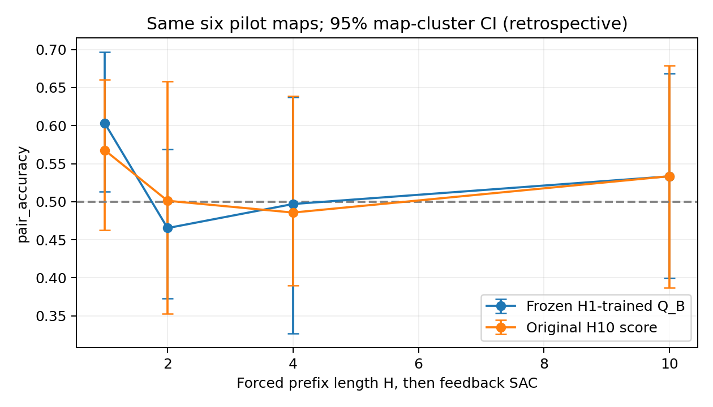
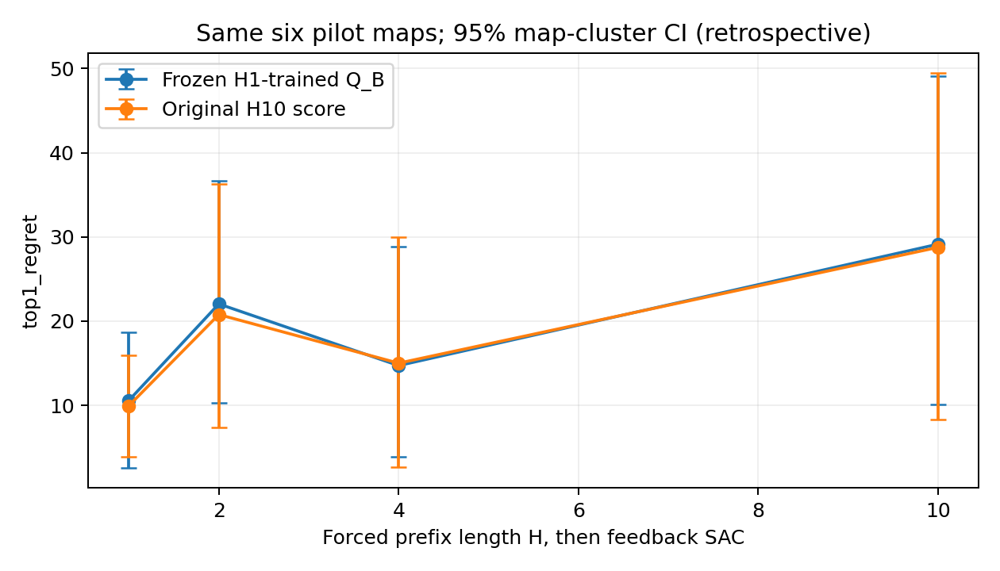
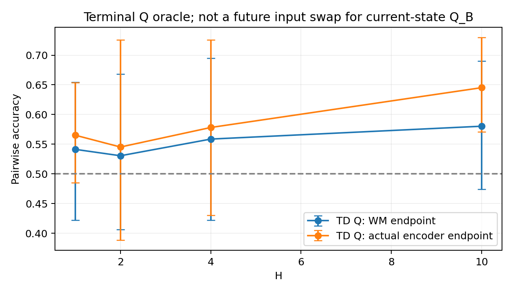
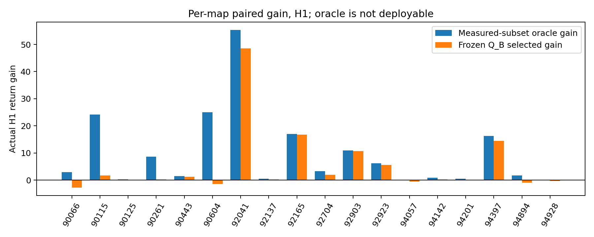
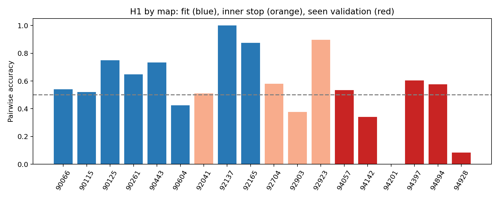
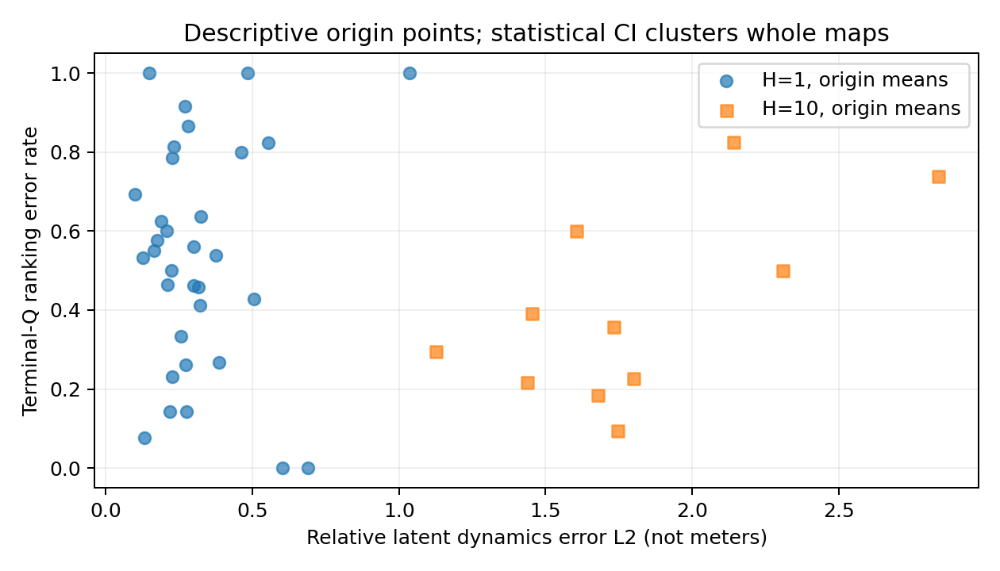

# MPPI First-Action Value Failure Attribution — Phase 2（2026-11-18）

## 结论：十个问题

1. **35.64%可准确复现，不是已发现的符号或样本错位。** 原方向地图宏准确率=35.638 [14.231, 53.699]%；训练68.662%、内部早停59.077%，验证35.638%。可确认跨地图泛化落差和动作相对收益区分偏弱，不能唯一证明是训练覆盖、监督目标还是表示信息缺失。

2. **评分方向没有反转Bug。** 输出是正scale还原的raw Return，argmax；Ranking loss为softplus(-sign(真实差)×预测差/10)，方向正确。反向准确率=64.362 [46.301, 85.769]%，但Regret由1.124增至2.222；反向也没有稳定优于随机的证据，禁止据此取负部署。

3. **没有证据证明H1在独立地图上明显优于H2/4/10。** H1与执行首动作的目标定义一致；其他时域只有6张Pilot地图、且都属于该模型fit数据，H1训练模型跨H比较属于目标外诊断。不能把更短时域较低的原始Regret直接解释成规划更优。

4. **候选未来WM Dynamics不能直接解释该Q_B的35.64%。** 此模型输入当前535+a0，不接收候选的预测未来latent；当前Encoder表示、共享WM派生上下文仍可能间接影响。未将当前535中的latent替换成未来latent，避免时刻错误和混合状态。

5. **真实末端状态没有可靠恢复原TD终端Q的排序。** H1纯latent替换的准确率变化=2.723 [-0.966, 6.361]个百分点，CI跨0；Regret改善=1.744 [0.121, 4.247]，说明Dynamics并非毫无影响，但不足以认定它是主要瓶颈。该对照不等于Q_B的输入替换或在线收益。

6. **候选确有正收益，但跨地图稳定潜力尚未充分证明。** 既有验证6图中仅3图含>1收益候选；Oracle=3.260 [0.325, 8.548]，减去原固定近等阈值1后=2.260 [-0.675, 7.548]，CI跨0。Oracle还带有事后最大化偏差，不能冒充可选政策。

7. **跨地图泛化不足。** fit只有8图/16个不同当前状态，虽有126条动作标签。验证预测候选分差范围均值0.462，真实收益范围4.916；16个状态并不等于126个独立上下文。

8. **只值得继续首动作相对收益可辨识性研究，不值得继续原样训练同类绝对Return评分头。** 下一步唯一主方向：冻结现有表示，审计同起点action-advantage监督及状态/道路交互覆盖。先预注册新诊断，不扩网络、不在已看过的验证图上反复选参。本轮未实施新训练。

9. **暂不转向整个WM或Dynamics重训。** 原TD终端Q有局部状态误差贡献；部分H10 Oracle在6张已见地图上高于机会水平，但配对提升区间仍跨0，尚不是新独立地图上的可靠恢复，且不是当前Q_B的未来状态通路。Dynamics只能作为后续受控子问题，不应自动替代本轮主要方向。

10. **不具备在线闭环验收条件。** 无新价值函数通过独立验证，无新闭环正收益与安全性证据；保留原默认MPPI与Lattice+SAC，未运行正式100场。

## 1. 版本、数据和统计边界

主main、实验worktree和2026-11-18 GitHub main均为`27f8131d95a39bfe2f4a95d101fef1774903b907`。实验分支`experiment/mppi-first-action-20261117`；主目录干净，上一轮新增源码/报告/测试仍未跟踪，尚未进入GitHub。新工作仅在`/home/kzb/kzb_code/tdmpc2/mpr_mpc_v2_first_action_20261117/reports/mppi_first_action_failure_20261118`及独立tools模块，未commit/push/reset/checkout/clean/pull。

Checkpoint SHA256=`4d0f1d43749794d1d1c28533309cbe75bc3712d25a92936ca7b477c30014810a`，沿用WM200k+RL300k总500k模型；没有悄悄换成WM500k+RL500k。配置SHA与包版本见experiment_manifest.json，逐文件数据SHA见data_sha256.csv；本轮结束已重新校验所有2631个旧输入文件。

576分支来自18图、36起点：571条非重复SAC接管分支，另4条原TD Actor/完整MPC对照和1条同seed重放。主要排序排除后两类，但完整索引保留全部576。H1=286条唯一SAC分支；H2/H4/H10各95条，只在6张Pilot图。无新场景或交通随机流重复；旧验证图现已属于“已看过数据”，不是本轮新独立验证。

真实Reward取原info.tdmpc2_reward，gamma=.995，近似平局仍为abs(ΔReturn)≤1。先同origin计算，后地图等权聚合，2000次整图Cluster Bootstrap、seed20261118。95%区间与上一轮seed1略不同，但35.637516%的点估计逐位复现。6图、4图的区间可靠性有限，不能用Pair数掩盖。

## 2. 动作、收益和早终止审计

提交给env.step的首动作及完整固定前缀均与保存候选一致；Baseline完整保留；有限性、边界、起点观测/latent与可记录状态/RNG哈希、gamma回报分解和done=terminated OR truncated均通过。按精确动作去重后的代表候选没有重复，也没有新增clip坍缩；原Gaussian裁剪前噪声未保存，不能反推裁剪比例。

原始动作是归一化steer/throttle物理控制命令，而非SAC残差；第0维转向、第1维油门/刹车，当前MetaDrive源码支持这一顺序。记录的是env.step提交值，未保存分支运行时实测轮角/引擎力，SI执行差异标为缺失，不假装已验证。action_mapping_scope.json保存源码位置和SHA。

H=1/2/4/10均为固定候选前缀→原Lattice+SAC每步反馈接管到原生done；不是前缀内反复跑MPPI。9条提前原生终止样本均保留在收益和Oracle分析；没有对应z_H时不造状态。纯状态对照标为matched_endpoint_subset，完整样本另报joint actual-state/reward/native-terminal；缺失Baseline时不伪造Baseline指标。具体样本见early_terminal_samples.json。

旧JSON actual_continuation_return一律是第一步后的RTG；H>1包括剩余固定候选前缀，不能叫纯SAC延续。本轮索引分列after_first、after_fixed_prefix及prefix_return，未改旧标签。原NPZ没有逐步crash/OOR/success，只记录累计episode标志和最终终止；能定位提前原生终止，但不能补造首个事故的时刻。

## 3. 方向、Pair规模与模型实现

|Split/H1|原方向Accuracy% [95%CI]|反方向Accuracy%|原Regret|反Regret|
|---|---:|---:|---:|---:|
|fit|68.662 [57.046, 81.342]|31.338 [18.658, 42.954]|7.987 [1.617, 15.537]|8.508 [3.121, 15.177]|
|inner_stop|59.077 [42.765, 79.974]|40.923 [20.026, 57.235]|2.245 [0.395, 5.260]|4.988 [3.112, 6.734]|
|seen_validation|35.638 [14.231, 53.699]|64.362 [46.301, 85.769]|1.124 [0.542, 1.871]|2.222 [0.412, 5.025]|

训练/推理F2都由原current535+同一candidate物理a0构造；加载同一个冻结checkpoint，归一化均值/方差从fit数据重算与保存buffer最大误差均为0。正target_scale、不含未来信息、larger-is-better与loss方向均已核实。没有在反向结果上重新选模型或拟合校准。

验证336原始Pair中140有效、196近平局；先起点再地图宏平均35.638%，混合所有有效Pair为45.357%（仅作诊断，不替代主指标）。地图94201仅3对有效、94928仅14对有效，准确率分别0%和8.333%，各仍占一张地图权重；这解释了宏/微平均差异，不能因此删掉它们或改平局阈值。

|H|原始Pair|有效Pair|近平局Pair|
|---|---:|---:|---:|
|H1|994|535|459|
|H2|329|219|110|
|H4|329|235|94|
|H10|329|274|55|

各图Pair数、分场景/起点、动作幅度、真实收益差、初速、episode碰撞/越界及固定交通density分层见scene_level_ranking.csv、pair_diagnostics.csv与ranking_analysis.json；所有分层Accuracy按地图bootstrap。真实道路曲率未保存，仅能使用原coarse-path曲率特征代理；traffic_density恒定0.1，没有虚构多个密度组。代理与实测道路曲率明确区分。

最终fit归一化Huber=0.108405，rank loss=0.687 [0.681, 0.691]，接近无差异log2≈0.693；正确方向pair probability=0.503 [0.501, 0.506]。这支持动作分差压缩的观察，但不是“某个loss权重就是唯一根因”的因果实验，不据此调整系数。

feature_shift_and_sensitivity.csv报告距fit当前上下文的标准化距离与a0梯度。fit=8图/16起点，stop=4图/8起点，旧validation=6图/12起点；模型/epoch经过小型stop集选择，存在选择与分布不确定性，不能把地图相关性直接当唯一原因。

## 4. 时域：同起点配对，而非混合不同地图

下表只比较同6张Pilot地图。原Q_B只训练过H1，且这些图属于fit；其跨H结果是目标外分析。原H10评分列固定同一套旧分数，真实标签随干预长度改变。原始Regret的收益尺度也随H变化，不将其直接当规划优劣。

|H|Q_B Accuracy%|原H10评分 Accuracy%|Q_B Regret|原H10 Regret|
|---|---:|---:|---:|---:|
|1|60.300 [51.341, 69.666]|56.765 [46.237, 65.998]|10.586 [2.549, 18.630]|9.959 [3.906, 15.923]|
|2|46.533 [37.272, 56.868]|50.123 [35.242, 65.820]|22.039 [10.302, 36.675]|20.777 [7.352, 36.246]|
|4|49.694 [32.659, 63.755]|48.571 [39.012, 63.879]|14.720 [3.847, 28.799]|15.007 [2.709, 29.994]|
|10|53.335 [39.947, 66.834]|53.350 [38.724, 67.911]|29.139 [10.128, 49.088]|28.760 [8.338, 49.460]|

H10与H1真实收益排序Spearman=-0.056 [-0.167, 0.042]。这显示干预目标差异，不能把H10标签当成H1；也不能把H1→Baseline接管当作新MPPI每步重规划的π_new闭环表现。

## 5. Predicted/Actual State Oracle 与Dynamics

**Q_B当前输入对照**：36个origin在正确current535+a0接口下A/B输入完全相同，没有候选未来latent可替换。换成z_H并留下原路径特征，会成为混合时刻输入，且评价Q_B(s_H,a0)而非原目标Q_B(s_t,a0)，因此未做这种无效实验。当前535中的WM派生coarse value仍可能间接影响表示，不声称完全排除所有WM因素。

**原TD终端Q对照**：同一冻结Encoder/Q、候选前缀、候选末端动作、gamma、固定历史Q成员对。J00=预测Reward+预测mask×Q(z_pred)；J01仅替换z；J10仅替换Reward；J11替换两者但保持原mask。joint另使用原生终止mask，明确不是纯Dynamics效果。所有真实观测只用于离线oracle，未训练或输入在线。TD Q训练涉及编码起点和imagined latent；不能保证新地图真实末端latent与其训练分布同分布，也不武断称其从未见过真实encoded状态。

|H|Latent-only Accuracy变化，百分点 [95%CI]|Regret改善|
|---|---:|---:|
|1|2.723 [-0.966, 6.361]|1.744 [0.121, 4.247]|
|2|1.472 [-4.425, 7.646]|3.049 [-1.676, 8.167]|
|4|1.953 [-7.507, 12.707]|0.339 [0.081, 0.627]|
|10|6.497 [-6.193, 18.850]|5.977 [-0.584, 14.355]|

H1有18图，其余仅6图且9条缺失末端，不能把跨行变化当纯H因果效应。状态替换有局部Regret贡献，Accuracy提升区间各H均跨0；Q/延续策略与训练覆盖依然存在。J00/J01/J10/J11完整评分、分split和严格同候选配对差异见state_oracle_ranking.json和predicted_vs_actual_state.csv。

按请求H统计latent MSE/cosine、rollout Reward误差、用真实前驱latent的teacher-forced Reward误差；差分Dynamics误差与排序错误在同origin内相关，再按地图bootstrap，见dynamics_error_analysis.json。没有仅凭latent距离较大断言因果，也没有把latent L2换算为米；缺少WM物理decoder及逐步真实XY/yaw，不能补造物理预测误差。

数值审计发现：不同8候选batch重算H10相对旧记录最大分数差0.155440。已归档初版state_oracle_recompute_v1；最终H10精确复用原predicted endpoint/prefix/mask，Actual替换保持原258候选Q batch，同形状Q校验最大差=0.000000。这是修复诊断可比性，未修改模型或默认规划评分。H1/2/4因旧文件无对应中间缓存，明确使用冻结模型重算。

## 6. Oracle、Random、Model 与影响分析

|Split/H1|Oracle Gain|Model Gain|固定Random Gain|>1收益地图数|
|---|---:|---:|---:|---:|
|fit|9.999 [3.540, 17.519]|2.012 [-0.857, 6.516]|2.474 [0.227, 5.291]|6/8|
|inner_stop|18.942 [4.767, 43.045]|16.697 [3.798, 37.785]|14.004 [0.857, 38.139]|4/4|
|seen_validation|3.260 [0.325, 8.548]|2.135 [-0.586, 7.157]|-0.015 [-0.736, 0.750]|3/6|

旧验证Model Gain=2.135 [-0.586, 7.157]；移除最大Oracle图94397后，Model Gain=-0.337 [-0.709, 0.049]。这仅是影响诊断，绝不把删图后结果叫新验证。Oracle包含Baseline所以必然非负，raw Oracle CI>0不等于一个已知、可泛化的动作选择政策；固定阈值1与any-positive比率、同seed重复非独立等限制均保留。

Random沿用上一轮预先固定的Gaussian候选角色，未重新抽有利样本；另给均匀非Baseline候选期望。逐origin的Baseline、Random、Oracle、Model Selected和Model Worst均在oracle_candidate_analysis.csv，含正收益比例、至少一个正收益候选、选正/误选负比例、收益差与Regret。候选子集并非完整Gaussian空间。

归因判定更接近情况A：确有有用候选，而当前评价不能可靠识别；同时新地图收益潜力较弱且受少数场景影响。不能排除候选覆盖不足，但还没有证据宣布搜索空间全无价值并重构Lattice。情况C（新模型闭环有效/无效）本轮没有新闭环，不冒充已验证。

## 7. 代码、测试、实时性和下一步

仅新增离线审计/统计、冻结推演、绘图与11项回归测试。原71项全部保留，82 passed。覆盖索引、Reward索引、H分解、早终止/截断、提交动作顺序/边界、同origin匹配、方向/平局、Oracle、地图bootstrap、输入隔离与真实默认规划输出一致性；测试成功不等于模型有效。

在原main与实验worktree各加载同一冻结WM与同一保存z0/Baseline，以相同RNG和默认64/8/4运行一次LocalMPPI，不启动MetaDrive；selected序列及标志逐元素一致。Checkpoint、原配置和全部旧数据文件结束时重新SHA核验，原在线文件无diff。没有改WM/SAC/Lattice/535/Action Mapping/Reward/Cost/Cost门控或默认采样/输出。

本轮没有新在线方案，故没有新增在线计算负担或新P95结论。旧同硬件完整规划P95：B≈76ms，M1≈104ms，M2≈117ms，M4≈141ms；仍高于100ms参考周期，不因离线Oracle改善而免除闭环收益、安全性和耗时门槛。

唯一下一阶段主方向：在冻结表示下研究**同起点首动作相对优势的可辨识性和上下文覆盖**，先明确什么信息能稳定解释动作收益差，再决定是否需要新的监督形式。不得直接加大MLP、翻转分数、切换在线选择、重训WM或复用已看过validation冒充独立验证。本轮不自动实施这个研究方案。

## 图表和交付索引

以下图均另存可导出的PDF，H时域曲线使用同6图；误差点按origin显示，统计区间按地图计算。

所有JSON/CSV/NPZ、完整代码diff、版本SHA、初始失败日志和诊断重算初版均保留在本目录。PHASE0_1_AUDIT.md与初始experiment_manifest.json是收到截断prompt时的阶段快照；本报告及verification.json为收到完整prompt后的最终交付。没有修改上一轮文件或重新运行其环境采集。

## 补充：完整分层指标及有利于Dynamics的证据

stratified_ranking.csv和stratified_ranking_statistics.json给出751个origin/分层记录的Accuracy、Spearman、Kendall、Regret、Baseline差值MAE、收益差相关性及场景级95%区间。动作幅度、相对Baseline收益差、episode crash/OOR、初速、coarse曲率代理、固定density均按预先规定阈值划分。各子集保留Baseline作共同参照，即使它本身不属于该层；因此子集Top1只是受限候选池的离线描述，不是实际在线选择，结果分层不能变成未来信息过滤器。Pair差值层另见pair_diagnostics.csv。

不能隐藏支持状态误差影响的结果。以下为相同末端可用子集（H1共18图，H10仅6张已见Pilot图，缺失末端另报）：

|H|预测状态J00 Accuracy%|真实状态J01 Accuracy%|真实Reward+状态J11 Accuracy%|
|---|---:|---:|---:|
|1|45.624 [33.854, 57.172]|48.347 [37.135, 59.305]|46.590 [35.182, 57.659]|
|2|53.052 [40.650, 66.836]|54.523 [38.829, 72.578]|55.433 [39.543, 73.023]|
|4|55.862 [42.199, 69.518]|57.815 [43.044, 72.544]|58.469 [43.353, 73.263]|
|10|58.028 [47.416, 68.978]|64.525 [57.048, 72.977]|63.305 [56.850, 70.134]|

H10部分Actual Oracle本身高于50%，是应保留的积极证据；但与同起点预测状态的配对提升CI仍跨0，且该子集是已见地图及可达末端，不足以部署或把它当新独立验证。H1 Regret改善CI大于0也不能抹掉；结论是Dynamics有贡献，尚未证明其解释了当前Q_B失效的主要部分。

H1同起点相对Dynamics误差与终端Q排序错误的Spearman=0.049 [-0.062, 0.142]；与真实收益差绝对值的Spearman=0.142 [-0.028, 0.321]。
H10同起点相对Dynamics误差与终端Q排序错误的Spearman=-0.117 [-0.207, -0.035]；与真实收益差绝对值的Spearman=0.219 [0.003, 0.410]。
关联并非统一正向，较大动作效应/收益间隔也可能更易排序；这些观察不构成“误差越大必然排错”或相反方向的因果证明。
