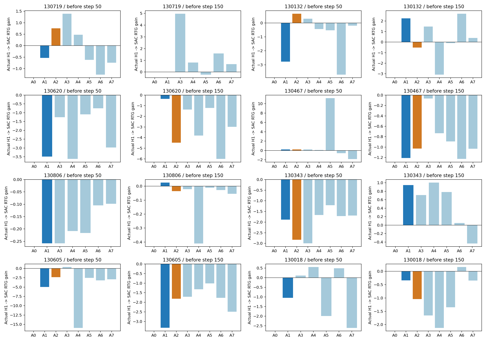
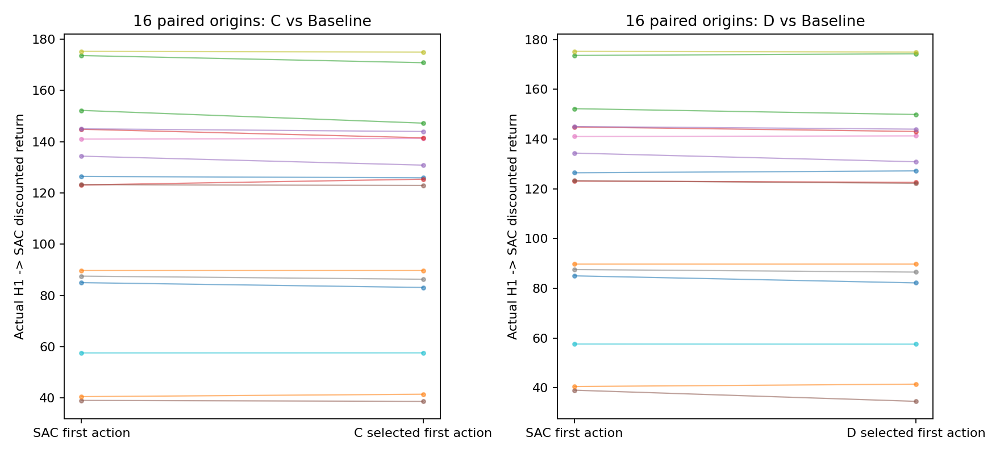
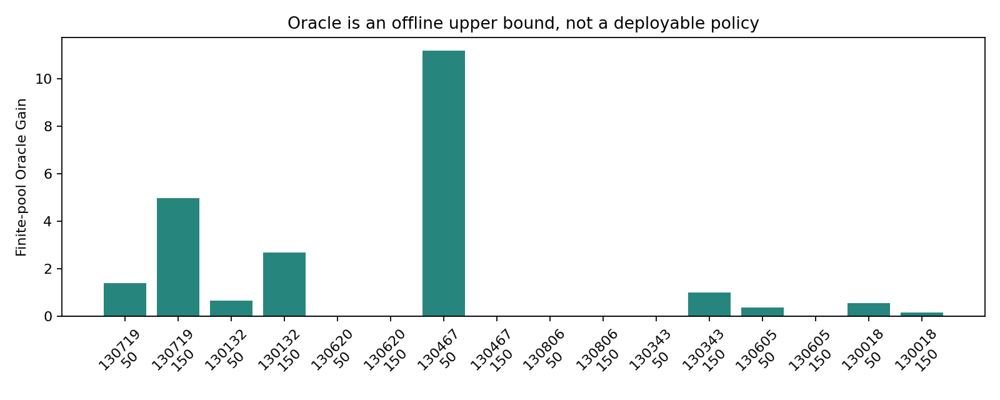
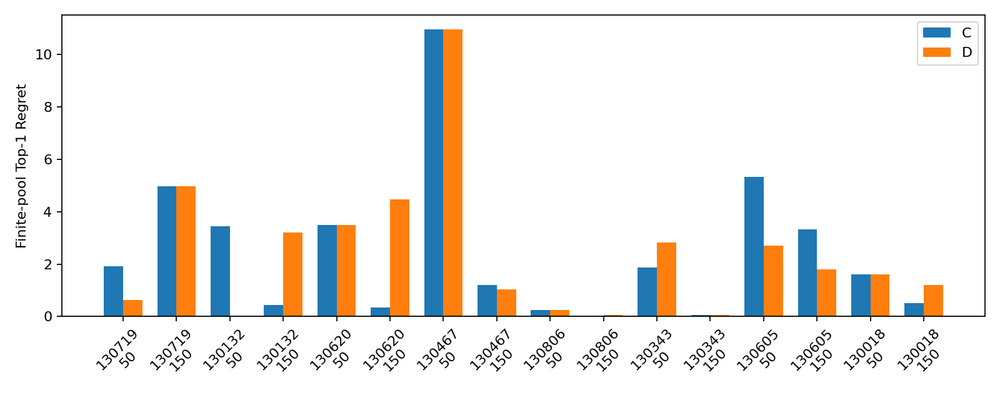
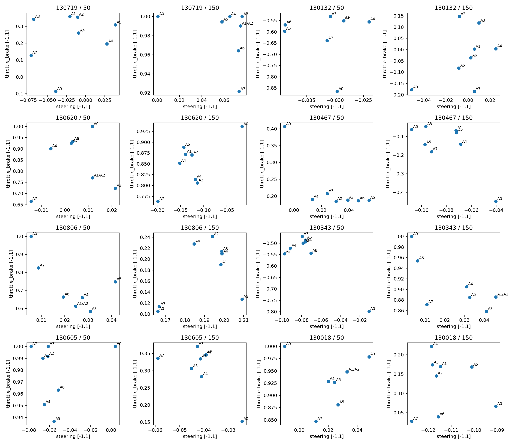
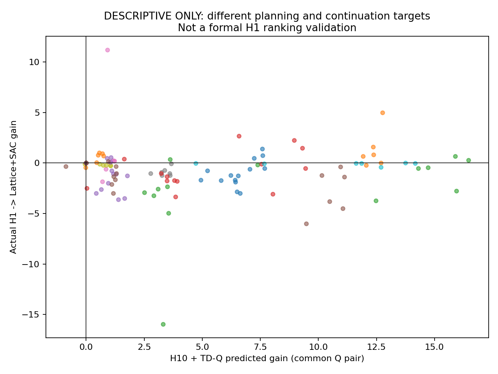

# MPPI H1 首动作真实反事实实验

**结论：当前有限候选池存在正收益，但C选择的平均H1收益为负，优先归为B：有限池内的评价/选择失效。**

停止扩大当前LocalMPPI在线投入，继续使用Lattice+SAC；不因此训练新头或修改默认评分。 本轮是8张已使用开发地图、16个预定状态的探索性反事实，不是新的独立验证，也不是正式100场。不能把123条执行分支当成123张独立地图。

## 开头直接回答8个问题

1. **候选中有真正优于SAC的动作吗？** 有限池Oracle Gain地图均值为+1.4395（地图聚类95%CI [+0.3077, +2.9409]），严格正收益起点10/16；较稳健的收益差>1起点5/16。Oracle只对本次6–8个左右的有限候选集合成立，不是连续动作空间全局最优，也不是可执行的预测模型。
2. **正收益动作状态占比？** 严格>0为62.50%，>1为31.25%。两种阈值同时报告，未根据结果选阈值。逐地图与每状态分布见oracle_gain_analysis.csv。
3. **MPPI最终首动作实际表现？** 原C Selected Gain -1.0457（地图聚类95%CI [-2.0412, -0.3512]），D -1.0184（地图聚类95%CI [-2.0058, -0.2362]）；C严格正收益5/16，D 5/16。C Top1 Regret +2.4852（地图聚类95%CI [+1.3185, +3.9472]），D +2.4579（地图聚类95%CI [+1.4182, +3.7978]）。
4. **能识别真实好动作吗？** 在Oracle Gain>1的5个起点，C选中收益>1的有1个，D有0个。以上是实际选择后果，不是假称模型H1排序准确率。正式H1 Spearman/Kendall/Pairwise Accuracy全部标为NOT ESTIMABLE：没有独立验证合格、匹配当前Lattice+SAC接管策略的V_SAC。
5. **明显WM预测偏差？** 实际C原生H10预测平均Selected Gain=5.9021，真实H1 Selected Gain=-1.0457；其目标不同，不能相减当作同目标校准误差。WM即时Reward MAE=0.0648，这才是同一步可直接配对的误差。H10分数与H1回报的相关性仅作描述，不证明H1价值排序能力，更不能单独归咎Dynamics。
6. **主问题属于哪一环节？** 当前有限候选池存在正收益，但C选择的平均H1收益为负，优先归为B：有限池内的评价/选择失效。 候选覆盖、原TD终端价值/继续策略不匹配及滚动交互的唯一因果贡献仍未全部分离。该实验直接识别的是一个动作改变后的同一B延续策略后果；不是持续MPPI策略的效果。
7. **是否继续投入LocalMPPI？** 停止扩大当前LocalMPPI在线投入，继续使用Lattice+SAC；不因此训练新头或修改默认评分。 无论均值方向如何，本轮均不能证明在独立地图上系统成功率提高。
8. **唯一下一实验？** 若继续研究，唯一下一实验是在预注册新地图上，将当前MPPI选择与同候选池预先固定的均匀随机选择做H1→SAC配对对照。它只验证现有评分是否提供超出无评分选择的真实价值，不训练网络，也不先改搜索。

## 1. 配对结果

| 首动作来源（此后全部B） | Success | Crash | OOR | Route completion | Safety Cost | Discounted Return |
|---|---:|---:|---:|---:|---:|---:|
| A0 SAC | 75.00% | 12.50% | 25.00% | 88.94% | 1.765 | 114.897 |
| A1 原C选中 | 75.00% | 6.25% | 25.00% | 88.96% | 1.776 | 113.851 |
| A2 原D选中 | 75.00% | 6.25% | 25.00% | 88.96% | 1.622 | 113.879 |

次要对照D−C的同起点折扣收益差为+0.0273（地图聚类95%CI [-0.7180, +0.8060]）；不将其与原持续MPPI的D−C混同。

这些是从指定状态开始的分支结果，非从地图初始时刻独立运行的16张地图；Crash/OOR按干预后任一真实事件统计，允许Success与Crash同为1，未修改原环境。每张地图两个起点先平均，再以8图聚类bootstrap2000次，seed20261118。安全配对差：

- C−A0：Crash -0.0625（地图聚类95%CI [-0.1875, +0.0000]）；OOR +0.0000（地图聚类95%CI [+0.0000, +0.0000]）；Success +0.0000（地图聚类95%CI [+0.0000, +0.0000]）。
- D−A0：Crash -0.0625（地图聚类95%CI [-0.1875, +0.0000]）；OOR +0.0000（地图聚类95%CI [+0.0000, +0.0000]）；Success +0.0000（地图聚类95%CI [+0.0000, +0.0000]）。

随机非baseline候选的均匀平均收益差为-0.8614（地图聚类95%CI [-1.7936, -0.0658]）。Oracle与随机基线均仅用于离线分析，不读取真实未来来执行在线动作。所有Leave-One-Map-Out值保留于paired_statistics.json；8地图区间可靠性有限，不以分支数夸大置信度。

地图敏感性：

- oracle_gain：正均值地图7/8；Leave-One-Map-Out均值范围[+0.8457, +1.6451]。
- C_selected_gain：正均值地图0/8；Leave-One-Map-Out均值范围[-1.1785, -0.6034]。
- D_selected_gain：正均值地图2/8；Leave-One-Map-Out均值范围[-1.2179, -0.5942]。

## 2. 状态恢复和流程放行

按固定地图与seed=scene+1，重放前49/149条原B动作。每步同时调用原策略重建Lattice缓存，并逐位核验计划动作、真实观测以及reward。目标周期原B快照保存于“目标决策计算完、env.step前”，故再计算一次A0后匹配原observation/vehicle/traffic/RNG全部哈希。并非错误重放50/150步。

所有16个A0分支不仅前10周期，而且整个余下轨迹的动作、观测、物理状态、reward、terminated/truncated/done均与原B逐步一致，总计4394个原生控制周期。所有其他分支也匹配同一起点原哈希、新policy指纹和扩展环境指纹。详见STATE_RECONSTRUCTION_AUDIT.md。

源B数据协议基线为`e26d669574e10d5184135f5fa629582371c45636`，本轮运行代码为`12da6bbfd40138b839eab35b0bd6d36dbb964eac`，两者SHA不同。本轮未默认启用Cartesian修正，B始终关闭MPPI；整段A0严格复现是新旧版本Baseline行为一致的实测证据，而非假设SHA相同。

单状态Phase1通过后，先在130719步50跑A1及3个Gaussian至原生done，检查仅1步干预、后续全SAC。通过Phase2后才准备其余起点；各起点A0完整复现后才放行剩余候选。所有gate和失败前诊断记录均保留。

最初扩展诊断触发了Gymnasium带副作用的np_random getter，创建原本未初始化的unused RNG，导致两个字段跨进程不一致，A0在执行前被阻止。修复的只是新增诊断工具：读取既有_np_random状态，保持None而不新建。引擎、manager、交通policy和全局RNG仍严格比较，不放宽容差。初始失败目录与state_diff.log完整保留，正式分支未使用该失败起点。

## 3. 动作注入与内部历史

原MPR评测每步编码真实观测，没有递归latent隐状态；原535 SAC是MLP。原TD `_prev_mean`仅在另一条nativeTD规划入口使用，所有分支执行前后不变。last_plan/last_result只作诊断，不作为上一实际动作读入。执行器不伪造训练residual transition，不调用observe或update。

首步实际MetaDrive steering/throttle逐位等于候选；下一周期vehicle.current_action及新SafetyContext.previous_action逐位等于实际执行动作，新的latent逐位等于冻结Encoder对真实后继obs的编码。后续每步都是原SAC，MPPI入口被执行器设为报错守卫，任何误用即失败；实际续航MPPI调用数全部0。因此不会只覆盖env.step而让一个有效历史输入继续记错动作。

## 4. 候选来源和预测目标

16起点中11个有8个独立首动作、5个去重为7个，总计123条分支。A0、实际C selected、实际D selected、C最后一轮Gaussian预测分位候选全部在真实结果前固定。保持64samples+baseline、8elites、4iterations、原std/rho/temperature/Q/gamma及Cost=0。没有手工候选、额外筛选或新模型。

实际捕获每轮65×11×2，最后一个Gaussian batch是iteration3；其后2×11×2的baseline/weighted-mean复评不是第五轮Gaussian。A3–A7只取最后一轮row1:65，稳定按该批原分数取分位。A1/A2是agent.act实际输出，不以best sampled action或加权均值名义替换。原trace、weighted mean、实际selected、原始Q成员和别名均保留。

候选生成器和执行器分进程；生成C/D使用相同pre-decision全局RNG及原私有采样seed，结束后恢复原B决策后RNG，核验环境和交通未变。执行器从不继承候选准备器的mutable planner cache。C/D动作是在相同B状态重新运行原C/D得到，不复制来自不同C/D真实轨迹状态的动作；本轮只有一个固定规划seed，不能外推所有采样随机性。

原H10分数附其原Q成员与批次；8角色另用同一个C最终双Q组合H10复评，仅作描述，不影响原选择。模型评分定义是H10候选前缀+TD-Q，而真实标签为H1后原B接管，故没有可信H1正式排名指标。candidate_ranking.csv逐项标明NOT ESTIMABLE，图中的H10/H1散点也明确目标不匹配。

## 5. 图表

## 6. 工程交付与限制

原线上代码、默认配置、WM/SAC权重及checkpoint完全未改，原数据重新hash一致。42项不同的相关测试通过，其中新增9项（初期41项，后补充地图聚类统计回归）；不把通过测试当作算法有效。本轮没有训练、微调、新网络、正式100场、commit或push。所有脚本/原始轨迹/结果在独立worktree本目录，主目录未改。

原始分支观测、动作、reward、cost、物理状态及done在branches/*/*/trace.npz，合并逐步日志在counterfactual_steps.csv；episode/role/候选/源数据hash及脚本指纹完整保存。源码Diff见code_changes.patch，运行说明见RUNNING.md。

仍有限制：只有8张已使用开发地图；每起点一个固定交通及规划seed；Oracle是有限集合后验最大值；未得到可信的匹配H1模型；不能把单步后B接管的结果当成持续MPPI重规划收益。没有通过独立场景的价值模型不进入在线规划。
