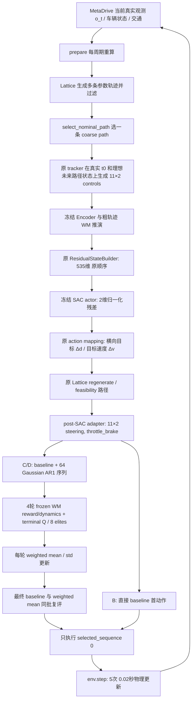

# 控制链路与时间关系审计

基线 main：`e26d669574e10d5184135f5fa629582371c45636`。本轮隔离目录为 `mpr_mpc_v2_root_cause_20261118`，主目录未修改。B/C 从干净 main 加载；D 从该隔离目录加载，仅显式开启 Cartesian virtual speed。

## 状态、动作空间、时间定义

| 环节 | 输入/输出 | 时间与实际执行含义 |
|---|---|---|
| `planning/structured_proposal.py:select_coarse` | 当前真实车/路/障碍→多条 `(target_d,target_speed,horizon)` 轨迹→一条 coarse | 保留完整候选对象用于诊断，但后续在线优化只围绕选中路径；未对其他路径进行真实反事实执行，不能声称 nominal 经常选错 |
| `planning/coordinator.py:prepare` | coarse→动作、冻结 latent、WM 特征、原535状态 | 每周期重新生成；粗轨迹特征未改 |
| `refine_and_plan` | 原 SAC actor 输出→原残差映射→重生轨迹 | SAC 两维是横向和目标速度参数残差，不是 steering/throttle |
| `planning/trajectory_adapter.py:path_to_actions` | 一条路径与真实当前车辆→`[H+1,2]` | 索引0使用真实车辆；索引 j>0 使用理想路径 `j*0.1s` 的 position/heading/speed。它不是由上一控制量积分得到的真实可达状态 |
| `planning/time_alignment.py:align_frenet_path` | 路径 t/XY/s_d→插值状态 | 查询时间0,0.1,...,1.0；超出路径结尾则保持末端位置；不是整体平移一个控制周期 |
| `planning/local_mppi.py` | baseline、当前 latent→局部物理控制序列 | 64个Gaussian加baseline；8elite、4轮；默认输出weighted mean与baseline比较的赢家。默认没有 `selection_mode` 字段，不能混同旧56回合显式 weighted_mean 的额外Elite诊断路径 |
| `planning/evaluator.py` | z_t 与 a0...a10 | 对 t=0...9，先 `two_hot_inv(reward(z_t,a_t))`，再 `next(z_t,a_t)`；gamma=.995；终止预测影响后续reward/terminal掩码；Q(z10,a10)是TD-MPC2 continuation定义 |
| `agent.py:act`→`env/env.py:step` | `selected_sequence[0]`→环境归一化动作 | 两维顺序 steering/throttle_brake；env转CPU数组并执行原动作空间约束，没有再走SAC残差映射；采样本来在[-1,1]，环境夹取应为恒等 |

当前 WM 评分严格为有预测终止掩码的 `Σ gamma^t r_hat + gamma^H Q_TD(z_H,a_H)`，Cost=0，未启用未经验证Cost。random_pair同批候选共用两位Q成员，但不同轮次和最终复评可能重新抽样。索引保存在逐轮 coverage 的 q_pair；随机性是原生机制，不能仅凭变化认定bug。

评价的a1...a10通常不会原样执行：下一次控制周期会重新计算 Lattice、粗轨迹风险/价值特征、SAC残差、重生路径、动作序列以及MPPI候选与分布。默认 warm-start=false，无上轮分布平移。a10是候选terminal Q动作；它不属于真实H10前缀执行的10个动作。

## 已确认的虚拟速度语义不一致及隔离修正

安装的 MetaDrive `BaseObject.speed` 源码返回世界速度模，单位m/s。路径 `s_d` 是 Frenet 纵向坐标导数；横向移动或弯道偏移时，它与世界XY轨迹速度模不相等。因此这是**同单位、不同物理量**的问题，不是km/h重复换算。原 adapter 将s_d直接传给 tracker，影响速度相关lookahead与油门。

D的唯一开关 `mpr_mpc.mppi.cartesian_virtual_speed=true`：在同一路径源时间上计算 `norm(gradient(XY,t))` 并插值；末端位置保持区间速度设0。仅作用于 post-SAC MPPI baseline 的虚拟未来状态。时间、XY、heading、原粗轨迹535语义、SAC、首动作、WM和搜索预算保持不变。该功能默认关闭，config.yaml逐字未改。

这是理想路径状态的一致性修正，不意味着车辆能无误差跟踪、不意味着末端能物理瞬停，也不解决末端TD-Q策略/滚动重规划之间的评价偏差。没有新增安全、Recovery、Emergency或在线审批。

## 实证与协议边界

`same_path_adapter_replay.csv`：36个预先指定时刻真实路径快照使用原控制器精确重放，原动作完全复现；首动作全不变，21个快照未来动作改变，最大分量差0.54536。

`D_preflight.json`：同一个真实状态复建、恢复相同Torch及私有采样RNG；原535、coarse controls、latent、SAC残差、refined parameters及baseline首动作均逐位相等。该直道状态未来动作也相同（差0），不能拿它证明未来动作一定变化；真实不同路径证据由上述36快照提供。

`action_alignment.csv`：逐步对照提交动作/实际车辆控制、control_dt、理想后继路径状态/真实车辆后继状态；不把tracker理想状态误差与WM latent预测误差混为一谈。`replanning_action_deviation.csv`比较旧计划未来动作与以后真正重新规划执行的动作。

历史 `prediction_vs_actual.csv` 明确记录 H1/2/4/10 **固定动作前缀后原Lattice+SAC接管**。新48个回合每步重新规划直到原生done，二者不互充标签。新同一条轨迹某步预测总值与其后滚动RTG的差，是模型和策略目标共同差异，不能解释为同策略纯校准误差。

所有地图和两次repeat种子在结果前冻结。B/C/D每一对初始 observation、vehicle、traffic、RNG 哈希逐项核验；统计单位是8张地图，非48个独立地图。并发采集耗时与后续单进程固定状态完整规划探针分开报告，不以GPU阶段时间冒充完整控制耗时。
